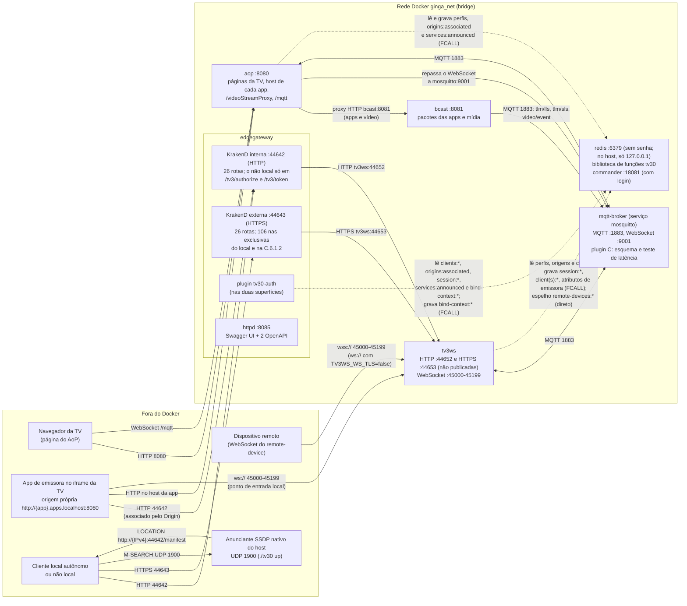
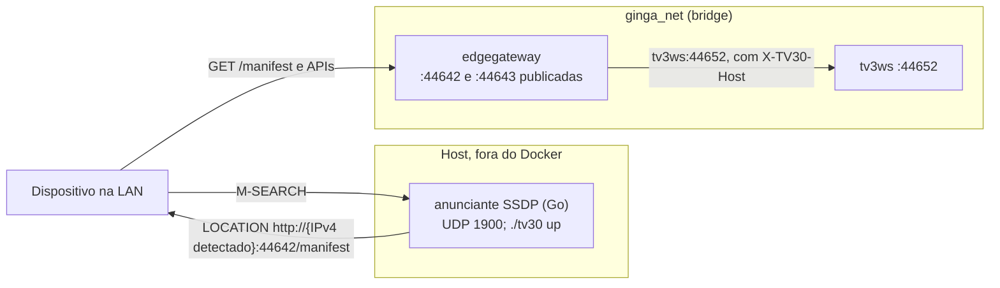

# Diagrama unificado

> Containers e portas vêm dos composes (`docker-compose.yml` da raiz do TV30, `infra/docker-compose.yml` e `infra/redis/docker-compose.yml`). Mensageria (MQTT), gateways (KrakenD) e Redis são decisões deste projeto e não aparecem na ABNT NBR 25608. Da norma vêm a porta 44642 do `Server-BaseURL` e a descoberta SSDP (Simple Service Discovery Protocol, C.3.4), as APIs de `/tv3` (Anexo C) e as classes de cliente (C.4.1).

## Stack padrão (bridge `ginga_net`)

Setas cheias: HTTP, WebSocket, MQTT ou SSDP. Setas tracejadas: Redis. O plugin `tv30-auth` roda dentro dos dois processos KrakenD e responde ele mesmo a C.6.8 (`/tv3/bind-context`) e a C.6.7.8/C.6.7.9 (`/tv3/api-info`); as demais rotas vão ao tv3ws ([04](04-pipeline-http.md)). O `PL` está separado no desenho só para mostrar o acesso ao Redis.

Pontos que o desenho não mostra:
- **Certificado do receptor.** O one-shot `tls-init` gera na primeira subida um certificado autoassinado em `.tv30/tls` da raiz. A borda o usa no TLS (Transport Layer Security) da 44643; o tv3ws, no HTTPS da 44653, no `serverCert` do pareamento e no ponto de entrada `wss://` do dispositivo remoto (`tv3ws/src/tls.ts`); o ponto de entrada local sai sempre em `ws://`. Sem certificado (tv3ws no host, sem configuração), o tv3ws sobe só em HTTP, e as rotas que a 44643 repassa respondem 404 `{"error":200}`.
- **Quem fala com o broker sem estar no desenho.** Os tópicos `aop/{serviceId}/currentApp`, `aop/{serviceId}/{appId}/path` e `.../doc/*`, que o tv3ws assina, não têm publicador neste repositório ([08](08-mqtt-map.md)).
- **One-shots da raiz.** `preflight` (rede e PID do host; confere portas; a borda só sobe depois dele), `userfiles-seed` (semeia `./user-files`), `tls-init` (certificado do receptor; a borda e o tv3ws só sobem depois dele) e `sysctl-init` (profile `linux`). Ver [02](02-rede-docker.md).
- **Ninguém fala HTTP com o tv3ws por dentro.** O AoP lê e grava o Redis direto e não usa a porta HTTP do tv3ws (comentário do serviço `aop` no compose da raiz); clientes só chegam ao tv3ws pela borda.

### Portas no host

| Container | Porta do container | Porta no host |
|---|---|---|
| `edgegateway` | 44642 (interna) | 44642, fixa (norma, C.3.4) |
| `edgegateway` | 44643 (externa) | 44643, fixa por padrão (`EDGE_EXT_PUBLISH=44643:44643`); só o número dá porta livre |
| `edgegateway` | 8085 (documentação) | livre, escolhida pelo Docker (`docker port edgegateway 8085`) |
| `tv3ws` | 44652, 44653 | não publicadas |
| `tv3ws` | 45000–45199 (`wss://` do dispositivo remoto, `ws://` do local) | as mesmas, fixas |
| `aop` | 8080 | `AOP_PUBLIC_PORT`, padrão 8080, fixa |
| `bcast` | 8081 | livre por padrão (`BCAST_PUBLISH`) |
| `mqtt-broker` | 1883 | 1883, fixa |
| `mqtt-broker` | 9001 (WebSocket) | livre por padrão (`MQTT_WS_PUBLISH`) |
| `redis` | 6379 | 6379, fixa, só em `127.0.0.1`, sem senha e sem ACL, a lista de controle de acesso do Redis |
| `redis` | 18081 (commander) | livre (`docker port redis 18081`) |

## Descoberta SSDP (anunciante nativo do host)

O anunciante roda no host, fora do Docker, em Linux, macOS e Windows; o `./tv30 up` (no Windows, `.\tv30.ps1 up`) o compila e sobe depois do compose. A borda fica sempre na bridge. O host do `LOCATION` é detectado (o IPv4 da interface do anúncio; `SSDP_ADVERTISE_HOST` é sobreposição opcional), e o `/manifest` sai com o mesmo host, pelo `X-TV30-Host`. Detalhes em [05](05-autenticacao.md#descoberta-ssdp).

