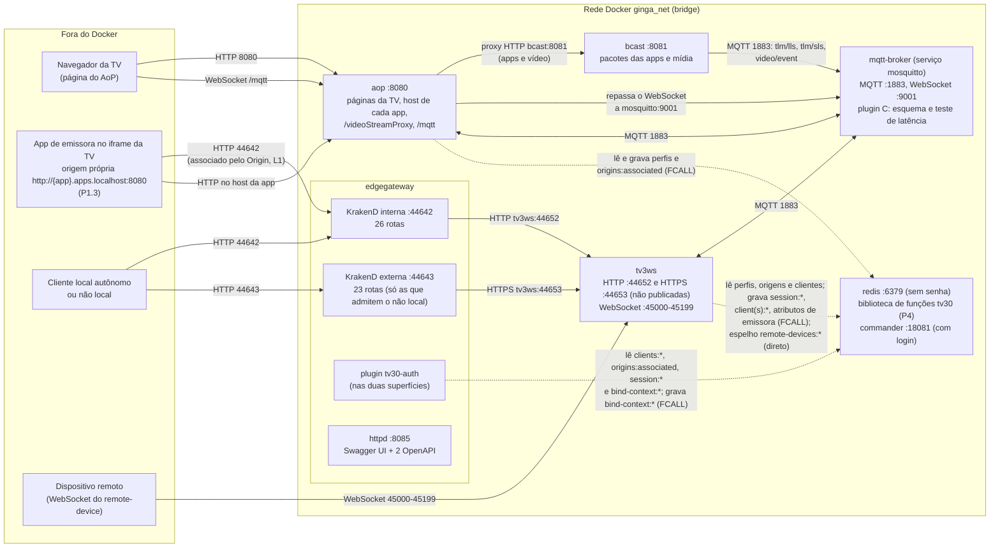
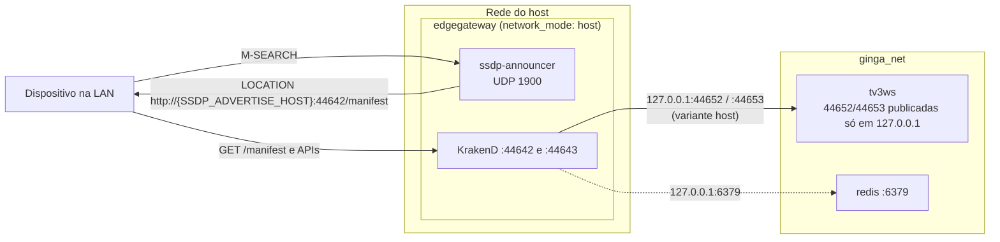
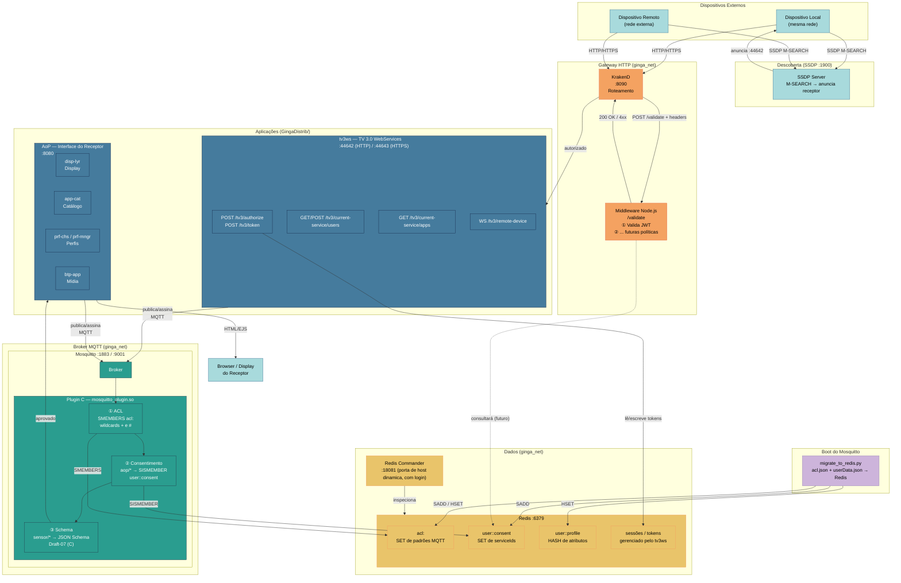

# Diagrama unificado — estado atual

> **Estado do código em 12/10/2026**, conferido nos composes (`docker-compose.yml` e `docker-compose.ssdp.yml` da raiz do TV30, `infra/docker-compose.yml` e `infra/redis/docker-compose.yml`) e no código de cada serviço. Até 12/10 este arquivo trazia só o diagrama de antes da consolidação, que ficou no fim, na seção [Até 02/10 (histórico)](#até-0210-histórico).
>
> Mensageria (MQTT), gateways (KrakenD) e Redis são decisões deste projeto e não aparecem na ABNT NBR 25608. Da norma vêm a porta 44642 do `Server-BaseURL` e a descoberta SSDP (C.3.4), as APIs de `/tv3` (Anexo C) e as classes de cliente (C.4.1).

## Stack padrão (bridge `ginga_net`)

Setas cheias: HTTP, WebSocket ou MQTT. Setas tracejadas: Redis. O plugin `tv30-auth` roda dentro dos dois processos KrakenD e responde ele mesmo a C.6.8 (`/tv3/bind-context`) e a C.6.7.8/C.6.7.9 (`/tv3/api-info`); as demais rotas vão ao tv3ws ([04](04-pipeline-http.md)). O `PL` está separado no desenho só para mostrar o acesso ao Redis.

Pontos que o desenho não mostra:
- **HTTPS do tv3ws.** O tv3ws só abre a 44653 com `HTTPS_KEY` e `HTTPS_CERT` no `tv3ws/.env` (`tv3ws/src/server.ts`). Sem elas, as rotas que a 44643 repassa ao tv3ws respondem 404 `{"error":200}` (o KrakenD não alcança o backend), e as que a própria borda responde continuam.
- **Quem fala com o broker sem estar no desenho.** Os tópicos `aop/services`, `aop/{serviceId}/currentApp`, `aop/{serviceId}/{appId}/path` e `.../doc/*`, que o tv3ws assina, não têm publicador neste repositório ([08](08-mqtt-map.md)).
- **One-shots da raiz.** `preflight` (rede e PID do host; confere portas e, no modo SSDP, o `SSDP_ADVERTISE_HOST`; a borda só sobe depois dele), `userfiles-seed` (semeia `./user-files`) e `sysctl-init` (profile `linux`). Ver [02](02-rede-docker.md).
- **Ninguém fala HTTP com o tv3ws por dentro.** O AoP lê e grava o Redis direto e não usa a porta HTTP do tv3ws (comentário do serviço `aop` no compose da raiz); clientes só chegam ao tv3ws pela borda.

### Portas no host

| Container | Porta do container | Porta no host |
|---|---|---|
| `edgegateway` | 44642 (interna) | 44642, fixa (norma, C.3.4) |
| `edgegateway` | 44643 (externa) | 44643, fixa por padrão (`EDGE_EXT_PUBLISH=44643:44643`, decisão do Luís em 12/10); só o número dá porta livre |
| `edgegateway` | 8085 (documentação) | livre, escolhida pelo Docker (`docker port edgegateway 8085`) |
| `tv3ws` | 44652, 44653 | não publicadas |
| `tv3ws` | 45000–45199 | as mesmas, fixas |
| `aop` | 8080 | `AOP_PUBLIC_PORT`, padrão 8080, fixa (C1) |
| `bcast` | 8081 | livre por padrão (`BCAST_PUBLISH`, C1) |
| `mqtt-broker` | 1883 | 1883, fixa |
| `mqtt-broker` | 9001 (WebSocket) | livre por padrão (`MQTT_WS_PUBLISH`, C1) |
| `redis` | 6379 | 6379, fixa, sem senha (D-L1) |
| `redis` | 18081 (commander) | livre (`docker port redis 18081`) |

## Modo SSDP (override `docker-compose.ssdp.yml`, só Linux nativo)

O override põe só a borda em rede do host (`EDGE_VARIANT=host`, `REDIS_HOST=127.0.0.1`, `SSDP_ENABLED=true`); o resto da stack continua na `ginga_net`. Detalhes em [05](05-autenticacao.md#descoberta-ssdp).

---

## Até 02/10 (histórico)

> **Registro, não estado atual.** Este é o diagrama de antes da consolidação dos containers, mantido sem alteração no desenho. Não existem mais no código: o KrakenD na porta 8090 com o middleware Node `/validate`; o controle de acesso (ACL) e de consentimento no plugin do broker, que hoje só valida esquema; o `migrate_to_redis.py` no boot do Mosquitto; as chaves `acl:*` e `user:{id}:profile`. As portas 44642/44643 são da borda, e o tv3ws escuta em 44652/44653 sem publicá-las. O estado atual está nas seções acima.

Visão completa do sistema: dispositivos, serviços, segurança, mensageria e dados.

