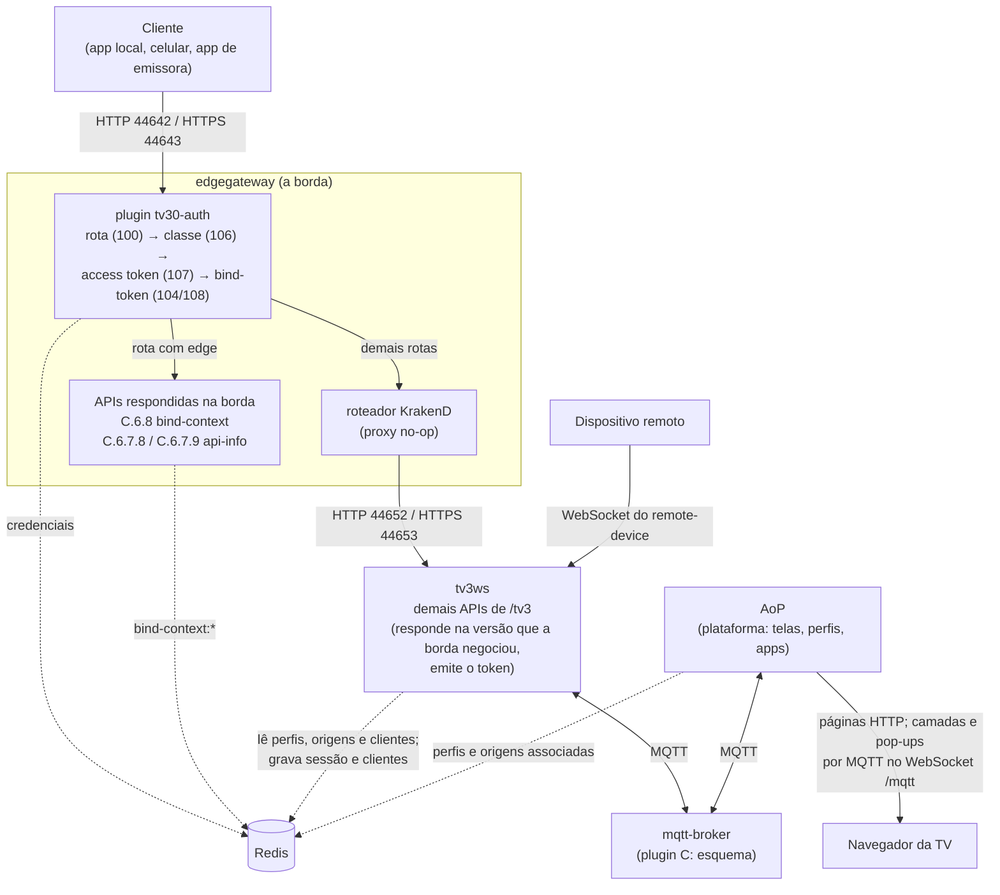

# Visão geral do sistema

> Containers e portas estão em [00](00-diagrama-unificado.md) e [02](02-rede-docker.md). Mensageria, gateways e Redis são decisões deste projeto; a ABNT NBR 25608 define as APIs e as classes de cliente, não onde elas rodam.

## O caminho de uma requisição de cliente

A borda é o único ponto que valida credencial: o tv3ws não confere token nem classe. Com `AUTH_ENFORCE=enforce` (padrão), as falhas de credencial são recusadas; com `warn`, opção explícita, as recusas de credencial (104, 107 e 108) só são registradas e marcadas com `X-TV30-Auth-Warn`. Detalhes em [04](04-pipeline-http.md) e [05](05-autenticacao.md).

Dois exemplos de interação que passam pelo broker:
- **Autorização (`GET /tv3/authorize`, C.6.1.2).** O tv3ws publica o pop-up sim/não em `aop/display/layers/popup/yesno/message`; a página da TV o mostra e publica a resposta em `.../yesno/response`; só `"true"` autoriza ([05](05-autenticacao.md)).
- **Troca de usuário corrente (`POST /tv3/current-service/users/current-user`, C.6.14.4).** O tv3ws grava `session:current-user` pela função `tv30_sessao_usuario` e publica `aop/currentUser` retido; o AoP, dono dos perfis, grava o `lastAccess` ([07](07-usuarios-perfis.md)).

## Responsabilidades por serviço

| Serviço | O que faz | Com quem fala |
|---|---|---|
| `edgegateway` | Validação de credenciais, C.6.8 e C.6.7.8/C.6.7.9, roteamento ao tv3ws, CORS e documentação (8085); o anúncio SSDP (C.3.4) roda fora dela, nativo no host | tv3ws (HTTP/HTTPS), Redis |
| `tv3ws` | Demais APIs de `/tv3`; emissão do access token; WebSocket do remote-device | broker (MQTT), Redis |
| `aop` | Telas da TV, gestor de perfis (dono de `users:index`, `user:{id}` e `user:{id}:consent`), lançamento das apps de emissora no host próprio de cada uma (`origins:associated`), proxy das apps e do vídeo, `/mqtt` | broker (MQTT e repasse do WebSocket), Redis, bcast (HTTP) |
| `bcast` | Simula a transmissão: publica LLS e SLS (`tlm/lls/...`, `tlm/sls/...`) e `video/event`, e serve os pacotes das apps e a mídia | broker (MQTT) |
| `mqtt-broker` | Barramento entre os serviços; o plugin C valida o esquema da publicação e responde ao teste de latência | ninguém (não consulta o Redis) |
| `redis` | Estado compartilhado; a biblioteca de funções `tv30` confere o esquema de toda escrita do código | ninguém |

