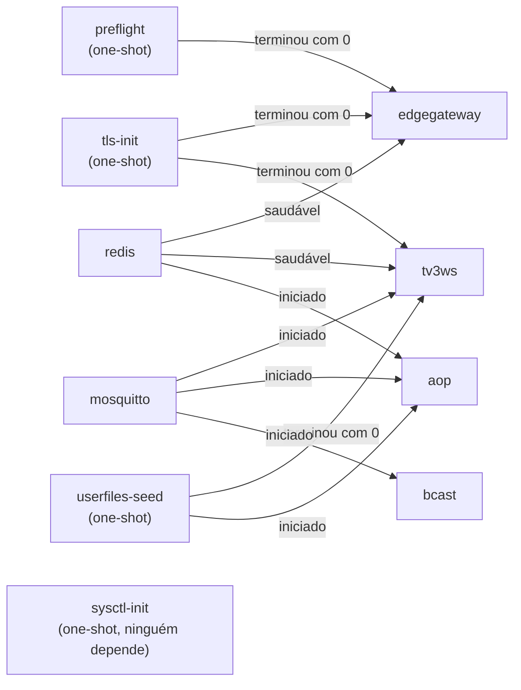

# Rede Docker

Containers, portas publicadas, redes e ordem de subida. O diagrama de quem fala com quem está em [00](00-diagrama-unificado.md).

## Um projeto, uma subida

A stack sobe de uma vez, com `docker compose up -d` na raiz do TV30. O compose da raiz tem nome fixo de projeto (`name: tv30`) e inclui o `infra/docker-compose.yml`, que por sua vez inclui o `infra/redis/docker-compose.yml`. O compose da `infra/` sozinho não é projeto válido: o `edgegateway` depende do `preflight`, que só existe na raiz ([README da infra](../README.md)).

Os profiles decidem o que sobe. O `.env.example` da raiz liga os dois (`COMPOSE_PROFILES=mqtt,linux`):
- sem profile (sobem sempre): `preflight`, `userfiles-seed`, `tls-init`, `edgegateway` e `redis`;
- `linux`: `tv3ws`, `aop`, `bcast` e `sysctl-init`;
- `mqtt`: `mosquitto` (container `mqtt-broker`).

## Containers

| Serviço (compose) | Container | Imagem | Rede | Compose |
|---|---|---|---|---|
| `preflight` | `tv30-preflight` | `alpine:3` (one-shot) | rede e PID do host | raiz |
| `userfiles-seed` | `tv30-userfiles-seed` | `alpine:3` (one-shot) | `tv30_default` (rede padrão do projeto, porque o serviço não declara `networks`) | raiz |
| `tls-init` | `tv30-tls-init` | `tv30-edgegateway` (one-shot; roda `tls-init.sh`) | `tv30_default` | raiz |
| `sysctl-init` | `tv30-sysctl-init` | `alpine:3` (one-shot, privilegiado) | rede do host | raiz |
| `tv3ws` | `tv3ws` | `tv30-tv3ws` | `ginga_net` | raiz |
| `aop` | `aop` | `tv30-aop` | `ginga_net` | raiz |
| `bcast` | `bcast` | `tv30-bcast` | `ginga_net` | raiz |
| `edgegateway` | `edgegateway` | `tv30-edgegateway` | `ginga_net` | `infra/` |
| `mosquitto` | `mqtt-broker` | `tv30-mosquitto` | `ginga_net` | `infra/` |
| `redis` | `redis` | `tv30-redis` | `ginga_net` | `infra/redis/` |

As imagens levam o prefixo `${DOCKERHUB_NS:-tv30}/` e a tag `${IMAGE_TAG}` (padrão `dev` nos serviços da raiz e `latest` nos da `infra/`; o `.env.example` define `IMAGE_TAG=latest`).

A `ginga_net` é uma bridge criada pelo próprio projeto (`name: ginga_net`, `driver: bridge`, declarada em `infra/docker-compose.yml` e `infra/redis/docker-compose.yml`, sem `external`). Dentro dela os serviços se acham pelo nome: `tv3ws`, `redis`, `mosquitto`, `bcast`.

## Portas publicadas no host

| Container | Porta do container | Porta no host | Onde se define |
|---|---|---|---|
| `edgegateway` | 44642 (superfície interna) | 44642, fixa (norma, C.3.4) | `infra/docker-compose.yml` |
| `edgegateway` | 44643 (superfície externa, HTTPS) | 44643, fixa por padrão | `EDGE_EXT_PUBLISH` (padrão `44643:44643`; só o número dá porta livre, que o `/manifest` não anuncia) |
| `edgegateway` | 8085 (documentação) | livre, escolhida pelo Docker | `infra/docker-compose.yml` |
| `tv3ws` | 44652, 44653 (API) | não publicadas | a borda chega a elas pela `ginga_net` |
| `tv3ws` | 45000–45199 (WebSocket do remote-device, `wss://` com o certificado do receptor; `ws://` com `TV3WS_WS_TLS=false`) | as mesmas, fixas | compose da raiz (`WS_PORT_MIN`/`WS_PORT_MAX`) |
| `aop` | 8080 | `AOP_PUBLIC_PORT`, padrão 8080, fixa | compose da raiz |
| `bcast` | 8081 | livre por padrão | `BCAST_PUBLISH` (padrão `8081`; `8081:8081` fixa) |
| `mqtt-broker` | 1883 (MQTT) | 1883, fixa | `infra/docker-compose.yml` |
| `mqtt-broker` | 9001 (MQTT por WebSocket) | livre por padrão | `MQTT_WS_PUBLISH` (padrão `9001`; por exemplo `9003:9001` fixa) |
| `redis` | 6379 | 6379, fixa, só em `127.0.0.1`, sem senha e sem ACL, a lista de controle de acesso do Redis | `infra/redis/docker-compose.yml` |
| `redis` | 18081 (redis-commander, com login) | livre, escolhida pelo Docker | `infra/redis/docker-compose.yml` |

A porta livre muda a cada criação do container: `docker compose port <serviço> <porta do container>` ou `docker port <container> <porta>` mostram qual saiu (por exemplo, `docker port edgegateway 8085`). A página da TV não usa a porta publicada da 9001: ela conecta em `ws://<host da página>/mqtt`, na porta do AoP, e o AoP repassa à 9001 do mosquitto pela `ginga_net` (`aop/src/mqtt-ws.js`).

## Ordem de subida

- **`redis` saudável** quer dizer biblioteca de funções `tv30` carregada nesta partida e carga inicial aplicada (marca `/tmp/tv30-redis-pronto` e chave `seed:done`; ver [`redis/README.md`](../redis/README.md)).
- **`preflight`** confere DNS e portas e só termina com erro num caso: a 44642 ocupada por outro processo. A borda então não sobe (`scripts/preflight.sh`).
- **`tls-init`** gera, na primeira subida, o certificado autoassinado do receptor em `.tv30/tls` da raiz (`key.pem` e `cert.pem`); nas seguintes, não muda nada (`infra/edgegateway/tls-init.sh`). A borda o monta em `/etc/tv30/tls` (TLS, Transport Layer Security, da 44643), e o tv3ws, em `/tls` (HTTPS da 44653, `serverCert` e `wss://`).
- **`aop`** usa a forma curta de `depends_on`, que só espera os containers iniciarem; ele mesmo tenta de novo a leitura dos perfis no Redis (`aop/src/core.js`, `loadUserData`).
- **`sysctl-init`** roda em paralelo; nenhum serviço espera por ele.

## Descoberta SSDP: fora do Docker

O anunciante SSDP (Simple Service Discovery Protocol, C.3.4) não é container: roda nativo no host, em Linux, macOS e Windows, e usa a UDP 1900 do próprio host. O `./tv30 up` da raiz (no Windows, `.\tv30.ps1 up`) sobe o compose e depois o anunciante; o `./tv30 down` o encerra antes do compose. A borda fica sempre na `ginga_net`. Detalhes em [05](05-autenticacao.md#descoberta-ssdp).

## Desenvolvimento com um serviço no host

Com `EDGE_VARIANT=windows`, as superfícies apontam para `host.docker.internal:44654` (interna) e `:44655` (externa) (`infra/edgegateway/routes.json`), e o `extra_hosts: host.docker.internal:host-gateway` faz o nome resolver também em Linux. O Redis continua sendo o do container. Fora do container, o tv3ws escuta por padrão só em `127.0.0.1` e, no Linux, também no IPv4 da `docker0`, se houver, por onde a borda chega ao host (`tv3ws/src/listen-hosts.ts`); `TV3WS_LISTEN_HOST` muda isso, e o compose o define como `0.0.0.0` no container. Ver `docs/dev-local.md` da raiz do TV30.

