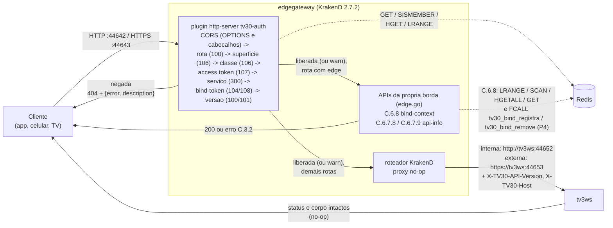
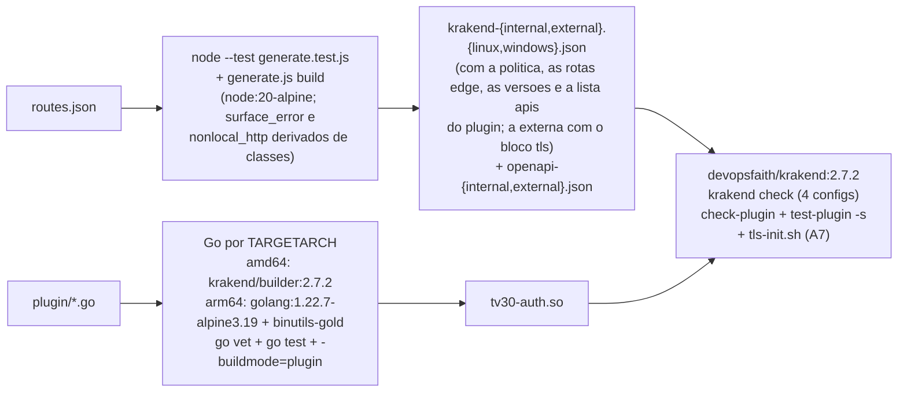

# Pipeline HTTP — a borda (`edgegateway`)

> **Estado do código em 2026-10-19** (revisto para as respostas do Joel de 15/10: `enforce` como padrão, TLS (Transport Layer Security) na 44643 (A7), as duas superfícies com todas as rotas e o 106 por superfície (F-1, E7), a versão negociada na borda (D1, D2 e D4) e o anunciante SSDP (Simple Service Discovery Protocol) fora da imagem).
>
> A versão anterior deste documento descrevia um desenho que nunca chegou a validar nada:
> - o KrakenD na porta 8090 delegava a validação a um middleware Node (`POST /validate`), que ninguém chamava;
> - o plugin `consent-validator` era só um proxy de qualquer caminho até o serviço.
>
> As duas peças saíram (`infra@f2eb652`). Mensageria, gateways e Redis são decisões do projeto e não aparecem na norma.

Todo cliente acessa a **borda**, nunca a implementação interna (D10). As portas de API do tv3ws (44652 e 44653) não são publicadas no host. O `edgegateway` é um container só, sempre na bridge `ginga_net`, com:
- **superfície interna:** 44642, HTTP, a única porta fixa da norma (C.3.4);
- **superfície externa:** 44643, HTTPS, com o TLS terminado no KrakenD (A7, Joel 15/10; TLS 1.2 no mínimo). O certificado autoassinado do receptor fica em `/etc/tv30/tls/cert.pem` e `key.pem`, montados de `.tv30/tls` da raiz do TV30; o serviço `tls-init` do compose da raiz o gera na primeira subida (`edgegateway/tls-init.sh`). No host, a 44643 é fixa por padrão (`EDGE_EXT_PUBLISH=44643:44643`, decisão do Luís em 12/10), porque o `/manifest` do tv3ws a anuncia;
- **documentação:** 8085, em porta de host livre (`docker port edgegateway 8085`).

Os configs das duas superfícies e os dois OpenAPI são gerados **no build** a partir de `edgegateway/routes.json`, a tabela única de rotas (M4).

**Superfícies (F-1 e E7, Joel 15/10; revisam a P1.9 do Luís, de 10/10).** As duas superfícies têm as 26 rotas da tabela. O `generate.js` (`SURFACE_RULES`) deriva das `classes` e da seção de cada rota o que muda entre elas:
- na externa, as rotas de uso exclusivo do cliente local (`POST` e `DELETE /tv3/bind-context`, a C.6.15.5 e as duas rotas por *handle*) e a C.6.1.2 (`/tv3/authorize`) levam `surface_error: 106` e respondem 106 a qualquer requisição (C.4.1.8);
- na interna, o access token de classe `non-local` fora de `/tv3/authorize` e `/tv3/token` recebe 106 (C.4.1.6).

Até 15/10, as rotas exclusivas do local não existiam na externa e davam 100 lá. A norma (C.3.4) só define o `Server-BaseURL` (HTTP, 44642) e o `Server-SecureBaseURL` (HTTPS, porta livre); duas superfícies são decisão do projeto. Detalhes em [05-autenticacao.md](05-autenticacao.md#política-por-rota).

## Fluxo por requisição

- **Plugin `tv30-auth`** (`edgegateway/plugin/`, em Go). Valida as credenciais segundo a política por rota de `routes.json`. Com `AUTH_ENFORCE=enforce` (padrão desde 15/10, Joel; vazio também vale), bloqueia. `warn` é opção explícita e transitória: nele, o 104, o 107 e o 108 só ficam no log e marcam a resposta com `X-TV30-Auth-Warn`; o 100, o 101, o 106, o 300 e o 200 saem nos dois modos.
  - Desde 12/10 (decisão do Luís, opção b), o CORS é todo dele: responde o `OPTIONS` (o preflight em qualquer caminho) e põe `Access-Control-Allow-Origin` e `Access-Control-Expose-Headers` em toda resposta. O módulo CORS do KrakenD saiu da configuração.
  - Um caminho não declarado recebe 100 sem chegar ao roteador.
  - **Versão (C.3.6; D1, D2 e D4, Joel 15/10).** A borda negocia em toda rota, pelas `versions` do `routes.json` (ausente = 2.0): sem `Accept-Version`, 2.0; fora do formato X.Y, 101; versão que a rota não serve, 100. Repassa a versão decidida no cabeçalho interno `X-TV30-API-Version` e o `Host` original em `X-TV30-Host` (que o `/manifest` usa), apagando os valores do cliente. O tv3ws não interpreta mais o `Accept-Version`. A C.6.15.5 serve 2.0 e 100.0; `GET` e `DELETE /tv3/remote-device/device/{handle}`, só 100.0 (a antiga "2.1", D1).
  - Um panic no roteador vira 404 com `{error: 200}`, e a resposta 5xx do próprio KrakenD (backend lento ou fora do ar, que sairia como 500 sem corpo) também, nos dois modos (`plugin/handler.go`, `serveNext`).
  - Desde a reunião de 05/10 com o Joel, é o único ponto que valida credencial: o tv3ws ficou "anônimo" (D-0510-1).
  - Detalhes em [05-autenticacao.md](05-autenticacao.md) e no [README do plugin](../edgegateway/plugin/README.md).
- **APIs respondidas pela borda** (reunião de 05/10 com o Joel). As rotas com o campo `edge` no `routes.json` são respondidas pelo próprio plugin, depois da mesma decisão de credencial, e não chegam ao tv3ws: a C.6.8 (`POST`, `GET` e `DELETE /tv3/bind-context`, D-0510-2, `plugin/bindcontext.go`; o `POST` e o `DELETE` dão 106 na externa, F-1) e a C.6.7.8/C.6.7.9 (`GET /tv3/api-info[/<api-id>]`, D-0510-3, `plugin/apiinfo.go`). A C.6.8 grava `bind-context:{serviceId}` no Redis: é a única escrita da borda. A lista da C.6.7.8/C.6.7.9 sai do campo `api` (id, seção e versão da Tabela C.2) das rotas no `routes.json`, que o `generate.js` entrega ao plugin: as 20 APIs, nas duas superfícies (F-2 revista pelo Joel em 15/10; de 11/10 a 15/10, a externa listava só as que oferecia). A versão informada é a mais recente que a rota serve (E2): 100.0 na C.6.15.5, 2.0 nas demais. O endpoint dessas rotas continua gerado no KrakenD, mas nunca é alcançado; ele só mantém o caminho registrado no roteador (escolha documentada no `generate.js`).
- **Roteador KrakenD.** Só repassa os cabeçalhos e as query strings declarados em cada rota (mais o `bind-token` nas rotas `token+bind` e os dois cabeçalhos internos, que o `generate.js` acrescenta). Toda rota repassada é proxy no-op: o erro do tv3ws (404 com corpo C.3.2) chega intacto ao cliente. A espera pelo tv3ws é o padrão do KrakenD (2 s), menos em `GET /tv3/authorize`, com `timeout` de 15 s no `routes.json`, porque o pop-up espera o espectador por 10 s.
- **HTTPS do tv3ws.** O backend da superfície externa é a 44653 do tv3ws, aberta com o mesmo certificado do receptor: no compose, `.tv30/tls` montado em `/tls` (`TV30_TLS_DIR`); fora dele, `HTTPS_KEY` e `HTTPS_CERT` (`tv3ws/src/tls.ts`). O KrakenD aceita o certificado autoassinado do backend (`allow_insecure_connections`). Sem certificado nenhum, o tv3ws sobe só em HTTP, e as rotas que a 44643 repassa respondem 404 `{error: 200}` (conexão recusada); as respondidas pela borda não mudam.
- **CORS.** `Access-Control-Allow-Origin: *`. No preflight, os cabeçalhos permitidos são `Content-Type, Authorization, bind-token, Accept, Accept-Version` (C.4.1.9.3), mais `key`, usado no `DELETE /tv3/bind-context` (C.6.8.4). Os cabeçalhos expostos são `Content-Length` e `X-TV30-Auth-Warn` (`cors.expose_headers`). **Quem responde o preflight, desde 12/10 (decisão do Luís, opção b), é o plugin `tv30-auth`,** em qualquer caminho e com a lista pedida em qualquer ordem: 200 com `Access-Control-Allow-Origin: *`, `Access-Control-Allow-Methods: *` (os valores padrão da C.4.1.9.3), o `Access-Control-Allow-Headers` acima e `Access-Control-Max-Age: 43200` (`cors.max_age`, 12 h). Até ali quem respondia o preflight era o módulo CORS do KrakenD 2.7.2, que não o concedia quando o `Access-Control-Request-Headers` vinha fora de ordem lexicográfica (`content-type,bind-token`; achado de 09/10). O módulo saiu da configuração, porque envolve o plugin e atendia o preflight antes dele; o `Access-Control-Expose-Headers` de toda resposta também passou ao plugin. Ver `KNOWN-ISSUES.md` da raiz do TV30.
- **Variantes.** `EDGE_VARIANT=linux` (padrão) aponta os backends para o DNS da rede (`tv3ws:44652` e `tv3ws:44653`). `EDGE_VARIANT=windows` aponta para `host.docker.internal:44654` e `:44655`, no cenário dev-host. Nos dois casos o Redis é o do container. A variante `host` saiu em 15/10, com o override `docker-compose.ssdp.yml`.
- **Anúncio SSDP (C.3.4).** Desde 15/10 (complemento do Joel), a imagem da borda não tem anunciante: ele roda nativo no host, subido pelo `./tv30 up` da raiz do TV30. Detalhes em [05-autenticacao.md](05-autenticacao.md#descoberta-ssdp).
- **Morre-inteiro.** Os dois processos KrakenD e o httpd da documentação são vigiados pelo `entrypoint.sh`: se um cair, o container todo cai. Configuração inválida do plugin também derruba o processo.

## Build

O `.so` só carrega num binário com o mesmo Go, a mesma libc e a mesma arquitetura. Por isso:
- o Go do build segue a arquitetura (`TARGETARCH`): em amd64, o builder oficial `krakend/builder:2.7.2`; em arm64, `golang:1.22.7-alpine3.19`, o mesmo Go e a mesma libc da `devopsfaith/krakend:2.7.2` arm64, com o `binutils-gold`, que o Go usa para ligar plugin em arm64. Outra arquitetura falha no build;
- as versões são **fixas**;
- o build falha se o plugin não carregar (`check-plugin` confere Go e libc contra o KrakenD).

O anunciante SSDP não entra na imagem: o `./tv30 up` o compila e testa no host ([05](05-autenticacao.md#descoberta-ssdp)).
