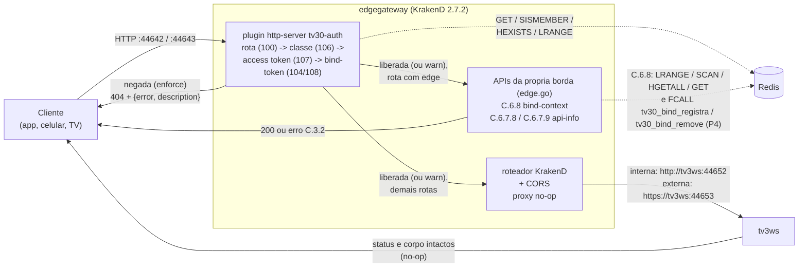
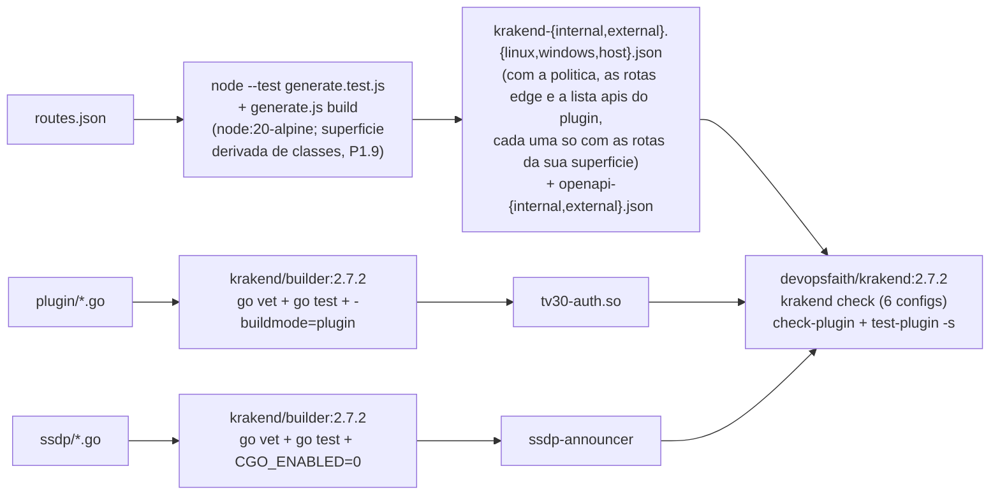

# Pipeline HTTP — a borda (`edgegateway`)

> **Estado do código em 2026-10-12** (revisto para as decisões da reunião de 05/10 com o Joel, para a P1.9, decidida pelo Luís em 10/10, para a A4, de 11/10, e para as decisões do Luís em 12/10: a 44643 fixa no host e a C.6.15.5 só para o cliente local).
>
> A versão anterior deste documento descrevia um desenho que nunca chegou a validar nada:
> - o KrakenD na porta 8090 delegava a validação a um middleware Node (`POST /validate`), que ninguém chamava;
> - o plugin `consent-validator` era só um proxy de qualquer caminho até o serviço.
>
> As duas peças saíram (`infra@f2eb652`). Mensageria, gateways e Redis são decisões do projeto e não aparecem na norma.

Todo cliente acessa a **borda**, nunca a implementação interna (D10). As portas de API do tv3ws (44652 e 44653) não são publicadas no host; com o override `docker-compose.ssdp.yml` da raiz do TV30, são publicadas só em `127.0.0.1`, para a borda em rede do host. O `edgegateway` é um container só, com:
- **superfície interna:** 44642, a única porta fixa da norma (C.3.4), com todas as rotas da tabela;
- **superfície externa:** 44643, só com as rotas que admitem o cliente não local (P1.9); no host, também 44643, fixa por padrão desde 12/10 (`EDGE_EXT_PUBLISH=44643:44643`, decisão do Luís), porque o `/manifest` do tv3ws a anuncia;
- **documentação:** 8085, em porta de host livre (`docker port edgegateway 8085`).

Os configs das duas superfícies e os dois OpenAPI são gerados **no build** a partir de `edgegateway/routes.json`, a tabela única de rotas (M4).

**Superfícies com rotas distintas (P1.9, decisão do Luís em 10/10).** A superfície de cada rota não é declarada: o `generate.js` a deriva do campo `classes` (ausente = todas as classes), pela tabela `SURFACE_RULES`. A externa recebe as rotas cujas `classes` incluem `non-local`; a interna recebe todas. O campo `surfaces` que cada rota tinha saiu do `routes.json`, e o build recusa quem o usar. Rotas sem restrição de classe, inclusive `/health` e `/manifest`, ficam nas duas. Hoje ficam fora da externa `POST` e `DELETE /tv3/bind-context` (só `local-associated`) e, desde 12/10 (decisão do Luís), `GET /tv3/remote-device/devices/{classId}` (C.6.15.5, só `local-associated` e `local-autonomous`). A externa tem 23 rotas, contra 26 da interna (25 e 27 até a A4, em 11/10; 24 e 26 de 11/10 a 12/10). A norma (C.3.4) só define o `Server-BaseURL` (HTTP, 44642) e o `Server-SecureBaseURL` (HTTPS, porta livre); conjuntos de rota distintos por superfície são decisão do projeto. Detalhes no [README do plugin](../edgegateway/plugin/README.md), seção *Superfícies (P1.9)*.

## Fluxo por requisição

- **Plugin `tv30-auth`** (`edgegateway/plugin/`, em Go). Valida as credenciais segundo a política por rota de `routes.json`. Com `AUTH_ENFORCE=warn` (padrão), só registra no log e marca a resposta com `X-TV30-Auth-Warn`; com `enforce`, bloqueia.
  - Um caminho não declarado para a superfície recebe 100 sem chegar ao roteador, inclusive a rota que só existe na outra superfície (P1.9).
  - Um panic no roteador vira 404 com `{error: 200}`, e a resposta 5xx do próprio KrakenD (backend lento ou fora do ar, que sairia como 500 sem corpo) também, nos dois modos (`plugin/handler.go`, `serveNext`).
  - Desde a reunião de 05/10 com o Joel, é o único ponto que valida credencial: o tv3ws ficou "anônimo" (D-0510-1).
  - Detalhes em [05-autenticacao.md](05-autenticacao.md) e no [README do plugin](../edgegateway/plugin/README.md).
- **APIs respondidas pela borda** (reunião de 05/10 com o Joel). As rotas com o campo `edge` no `routes.json` são respondidas pelo próprio plugin, depois da mesma decisão de credencial, e não chegam ao tv3ws: a C.6.8 (`POST`, `GET` e `DELETE /tv3/bind-context`, D-0510-2, `plugin/bindcontext.go`; o `POST` e o `DELETE` só na interna, P1.9) e a C.6.7.8/C.6.7.9 (`GET /tv3/api-info[/<api-id>]`, D-0510-3, `plugin/apiinfo.go`). A C.6.8 grava `bind-context:{serviceId}` no Redis: é a única escrita da borda. A lista da C.6.7.8/C.6.7.9 sai do campo `api` (id, seção e versão da Tabela C.2) das rotas de cada superfície no `routes.json`, que o `generate.js` entrega ao plugin: 20 APIs na interna e 17 na externa (18 até 12/10, quando a C.6.15.5 saiu da externa). O endpoint dessas rotas continua gerado no KrakenD, mas nunca é alcançado; ele só mantém o caminho registrado no roteador (escolha documentada no `generate.js`).
- **Roteador KrakenD.** Só repassa os cabeçalhos e as query strings declarados em cada rota (e o `bind-token` nas rotas `token+bind`, que o `generate.js` acrescenta). Toda rota repassada é proxy no-op: o erro do tv3ws (404 com corpo C.3.2) chega intacto ao cliente. A espera pelo tv3ws é o padrão do KrakenD (2 s), menos em `GET /tv3/authorize`, com `timeout` de 15 s no `routes.json`, porque o pop-up espera o espectador por 10 s.
- **HTTPS do tv3ws.** O backend da superfície externa é a 44653 do tv3ws, que só abre com `HTTPS_KEY` e `HTTPS_CERT` no `tv3ws/.env` (`tv3ws/src/server.ts`). Sem elas o tv3ws sobe só em HTTP, e as rotas que a 44643 repassa respondem 404 `{error: 200}` (conexão recusada); as respondidas pela borda não mudam.
- **CORS.** `Access-Control-Allow-Origin: *`. No preflight, os cabeçalhos permitidos são `Content-Type, Authorization, bind-token, Accept, Accept-Version` (C.4.1.9.3), mais `key`, usado no `DELETE /tv3/bind-context` (C.6.8.4). Os cabeçalhos expostos são `Content-Length` e `X-TV30-Auth-Warn` (`cors.expose_headers`). **Achado de 09/10:** o módulo CORS do KrakenD 2.7.2 não concede o preflight quando o `Access-Control-Request-Headers` vem fora de ordem lexicográfica (`content-type,bind-token`), em qualquer rota; em ordem (`bind-token,content-type`), como os navegadores mandam, passa. Ver `KNOWN-ISSUES.md` da raiz do TV30.
- **Variantes.** `EDGE_VARIANT=linux` aponta os backends para o DNS da rede (`tv3ws`). `EDGE_VARIANT=windows` aponta para `host.docker.internal`, no cenário dev-host. `EDGE_VARIANT=host` aponta para `127.0.0.1:44652/44653`, com a borda em rede do host; quem a define é o override `docker-compose.ssdp.yml` da raiz do TV30, que também faz o plugin ler o Redis em `127.0.0.1` (a 6379 publicada). Nos três casos o Redis é o do container.
- **Anúncio SSDP (C.3.4; L6, opção A, decidido pelo Luís em 09/10).** Com `SSDP_ENABLED=true`, que o mesmo override liga, o `entrypoint.sh` sobe também o anunciante `ssdp-announcer` (`edgegateway/ssdp/`, em Go). Detalhes em [05-autenticacao.md](05-autenticacao.md#descoberta-ssdp).
- **Morre-inteiro.** Os dois processos KrakenD, o httpd da documentação e, quando ligado, o anunciante SSDP são vigiados pelo `entrypoint.sh`: se um cair, o container todo cai (para o anunciante, decisão do Luís em 09/10). Configuração inválida do plugin também derruba o processo. O anunciante só sai por erro de configuração do anúncio; na falta de rede, ele espera e tenta de novo, sem sair (decisão do Luís em 10/10; ver `05-autenticacao.md`).

## Build

O `.so` só carrega num binário com o mesmo Go, a mesma libc e a mesma arquitetura. Por isso:
- o builder e a imagem final usam a **mesma versão fixa**;
- o build falha se o plugin não carregar.
