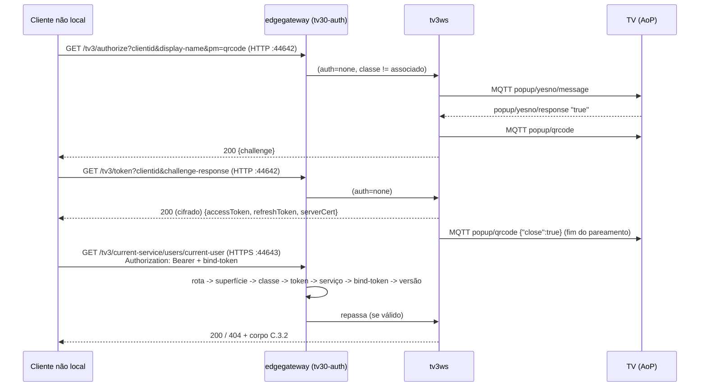
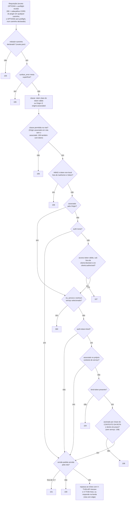
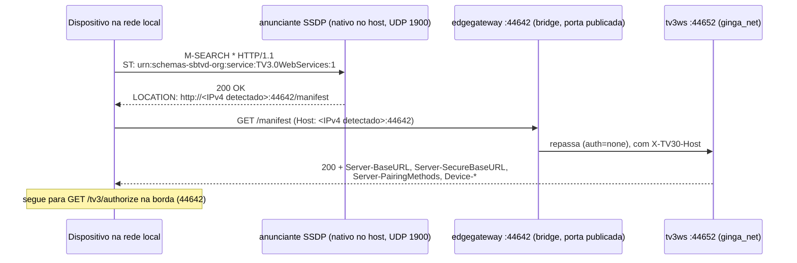

# Autenticação e validação de credenciais (TV 3.0)

> Cobre o tv3ws, o plugin `tv30-auth` da borda e o anunciante SSDP (Simple Service Discovery Protocol, a descoberta da C.3.4). Onde este texto cita a norma, a seção é da ABNT NBR 25608 (Anexo C). Onde descreve mensageria, gateways ou o Redis, trata-se de decisão do projeto.

## Classes de cliente

A classe é definida **uma vez**, na autorização (`GET /tv3/authorize`, em `tv3ws/src/api/client-identification/controller.ts`). Ela viaja no claim `class` do access token e nunca é reinferida a partir do endereço de rede.

| Classe (claim `class`) | Como é reconhecida | Credenciais nas APIs |
|---|---|---|
| `non-local` | `pm` (`qrcode` ou `kex`) presente no `/authorize` | access token; bind-token nas APIs protegidas. Fora de `/authorize` e do primeiro `/token`, a norma exige HTTPS (C.4.1.6, erro 106): na 44642 (HTTP), a borda responde 106 ao access token dessa classe fora de `/tv3/authorize` e `/tv3/token`, e o tv3ws dá 106 à renovação do token por HTTP. |
| `local-autonomous` | sem `pm`, e `Origin` fora de `origins:associated` | access token; bind-token nas APIs protegidas |
| `local-associated` | `Origin` presente no hash `origins:associated`, que o AoP grava ao lançar a app (origem própria da app → `globalServiceId` do serviço corrente; sem serviço corrente, a origem não é gravada) | nenhuma no próprio contexto de serviço (C.4.1.1); fora dele, bind-token válido daquele contexto |

O reconhecimento do local associado pelo `Origin` é decisão do projeto, com o risco aceito. Os limites conhecidos:
- **Risco aceito:** fora do navegador, o `Origin` pode ser forjado, e um `Origin` forjado presente em `origins:associated` passa como associado;
- **origem própria por app:** o AoP abre cada app na origem `http://<rótulo>.<APPS_DOMAIN>:<AOP_PUBLIC_PORT>` (padrão `<rótulo>.apps.localhost:8080`; `aop/src/app-hosts.js`), roteia pelo cabeçalho `Host` e grava essa origem ao lançar a app (`aop/src/core.js`); é o `Origin` que o navegador manda nas chamadas dela. O rótulo sai de um `appId` fixo por app (`urn-tv30-app-users-test`, por exemplo), e a URL leva o prefixo `/graphicsAppProxy`, que não entra no `Origin`. O caminho `/graphicsAppProxy` no host do AoP redireciona (302) para o host da app. Com a tela do AoP aberta de outra máquina, `*.localhost` não aponta para o AoP, e as apps não carregam (`APPS_DOMAIN` aceita um domínio resolvível na rede);
- a C.4.1.7 manda o associado usar uma porta de origem atribuída pelo gerenciador de componentes e diz, na mesma seção, que o mecanismo de diferenciação é decisão de implementação. O `Origin` é a decisão deste testbed.

## Emissão do access token (tv3ws)

### `GET /tv3/authorize?clientid=<uuid>&display-name=<nome>[&pm=qrcode|kex[&key=<pub ECDH>]]` (Tabela C.3)

1. O tv3ws publica um pop-up sim/não na TV pelo tópico `aop/display/layers/popup/yesno/message`, com timeout de 10 s (`client-identification/service.ts`).
2. Só a resposta `"true"` no tópico `.../yesno/response` autoriza: o cliente entra em `clients:authorized` (ver abaixo) e ganha o registro `client:{id}`. A AoP publica `"false"` quando o espectador recusa e também quando o pop-up expira. Nesse caso, ou sem resposta em 10 s, o cliente vai para `clients:blocked` e a resposta é **102**.
3. **Local autônomo:** a resposta é `{"refreshToken": ...}`. O associado recebe 106, sem pop-up (Tabela C.3, "If invoked from an associated local client").
4. **`clientid` já usado:** 101, para o autônomo e o não local, sem pop-up, tanto para o cliente já autorizado quanto para o recusado (`clients:blocked`): Tabela C.3, "if clientid has been used before", e C.6.1.4.4; para o recusado, também a nota da Tabela C.3 ("any attempt to authorize immediately returns error 101, without displaying the authorization dialog").
5. **Não local:**
   - **`qrcode`:** depois do sim, a TV mostra um QR code com uma chave de 32 bytes. O segredo é SHA-256(chave)[0:16]. A resposta é `{"challenge": ...}`.
   - **`kex`:** ECDH P-256. A TV mostra um PIN igual a hash mod 10000, e o segredo é SHA-256(segredo ECDH)[0:16]. A resposta é `{"challenge": ..., "key": ...}`, com `key` = chave parcial do servidor (ponto SEC 1 sem compressão, base64url; Tabela C.3, formato 3, e C.4.3.4).
   - O `challenge` é uma string aleatória cifrada em AES-128-ECB com o segredo. O tv3ws guarda o SHA-256 dela em bytes (`generateChallenge`, em `client-identification/service.ts`).
   - **O pop-up do QR code e o do PIN ficam na tela até o fim do pareamento.** O fim do pareamento é o `/tv3/token` que confere a solução do desafio com sucesso (abaixo): logo depois da resposta, o tv3ws publica `{"close":true}` no mesmo tópico do pop-up (`aop/display/layers/popup/qrcode` ou `.../pin`; `endPairing`, em `client-identification/service.ts`, e `closeQRCodePopUp`/`closePINPopUp`, em `tv3ws/src/core.ts`), e a camada gráfica fecha o pop-up daquele tipo (`handlePopupMessage`, em `aop/public/js/popup.js`). É o que pedem a C.4.3.2 ("When this stream ends, the pop-up with the QR code is removed from the receiver screen, which informs that the pairing has been successful") e a C.4.3.3 ("the pop-ups for filling out the PIN are removed from both the non-local client's screen and the TV 3.0 receiver"). Trava de segurança: o pop-up vai com prazo de 120 s (`PAIRING_POPUP_TIMEOUT_MS`), e a página o fecha sozinha no fim dele, se o cliente desistir. O valor é decisão do projeto; a norma não fixa prazo.
   - O `/tv3/token` que falha não fecha o pop-up, e não há caminho em que o pareamento falhe de vez: o desafio errado dá 102 e a tentativa continua aberta ([Lacunas](#lacunas)). O fim do pareamento de um cliente só fecha o pop-up se ele ainda for o desse cliente (em memória). O pop-up de outro cliente não toma o lugar dele: um `/tv3/authorize` novo recebe 103 enquanto houver na tela um sim/não esperando resposta, ou o QR code ou o PIN de um pareamento (`reservarCamada`, em `client-identification/service.ts`; C.4.2.3). A camada libera no fim do pedido, no sucesso do pareamento ou no fim da trava de 120 s. O aviso da C.6.14.5 espera numa fila própria ([08](08-mqtt-map.md)).

Erros possíveis no `/authorize`:

| Código | Situação |
|---|---|
| 106 | `Origin` em `origins:associated`. Vem antes dos demais. A borda recusa antes, nos dois modos (abaixo). |
| 105 | Falta `clientid`, `display-name` ou `key` (no `kex`). Parâmetro vazio ou só com espaços conta como ausente (`queryParam`, em `client-identification/controller.ts`; Tabela C.3). |
| 101 | `pm` não suportado, ou `clientid` já usado (autorizado ou bloqueado), para o autônomo e o não local. `pm=` vazio vale como ausente, e o cliente se classifica local. |
| 102 | O espectador recusou no pop-up (ou o pop-up expirou). |
| 103 | A camada gráfica está ocupada pelo sim/não de outro pedido, ou pelo QR code ou o PIN de um pareamento (C.4.2.3; Tabela C.3, "When the TV 3.0 receiver is unable to display the authorization pop-up"). Vale também para o mesmo `clientid`. Vem depois do 105 e do 101, antes do pop-up. |

### `GET /tv3/token?clientid=<uuid>&(challenge-response=<...>|refresh-token=<...>)` (Tabela C.4)

- **Resposta:** `{"accessToken", "tokenType": "Bearer", "expiresIn", "refreshToken"}`. O refresh token é rotacionado a cada chamada.
- **Primeiro acesso do não local** (por HTTP, com `challenge-response`): a resposta vem cifrada (`application/octet-stream`) e inclui `serverCert`: o certificado do receptor, o mesmo da 44643 (`tv3ws/src/tls.ts`).
- **Com os dois parâmetros,** vale o `refresh-token`. Parâmetro vazio ou só com espaços conta como ausente (Tabela C.4, 105), e um dos dois ramos sempre roda.
- **O desafio vale uma vez.** No `challenge-response` conferido, o tv3ws tira do cliente o material do pareamento (challenge, chave simétrica e par ECDH) no mesmo trecho síncrono da conferência (`takePairingMaterial`, em `tv3ws/src/modules/auth-manager/client.ts`), e dois `/tv3/token` simultâneos com a mesma resposta não passam os dois. A Tabela C.4 permite descartar a chave depois do primeiro acesso ("In subsequent accesses, the use of the symmetric encryption key is no longer necessary and it can be discarded"). Se a emissão falhar depois da conferência, o material volta ao cliente e a tentativa segue aberta. O material do pareamento vive só na memória do tv3ws: um reinício o perde.
- **Comparações em tempo constante:** o refresh token e a resposta ao desafio são comparados com `crypto.timingSafeEqual` sobre os bytes (`safeEqual`, em `tv3ws/src/util/encryption.ts`), e tamanhos diferentes são falha. A resposta decifrada é comparada em bytes com o SHA-256 guardado. `refresh-token` repetido na URL (lista) não vale (101).

Erros possíveis no `/token`:

| Código | Situação |
|---|---|
| 105 | Falta `clientid`, ou faltam os dois: `challenge-response` e `refresh-token`. Vazio ou só com espaços conta como ausente. |
| 102 | Cliente fora de `clients:authorized` (nunca autorizado, ou bloqueado depois); `challenge-response` errado, inclusive o que decifra para um tamanho diferente do hash e o que não decifra (tamanho ou *padding* inválido no AES-128-ECB, ou o parâmetro repetido na URL); e `challenge-response` sem desafio pendente: repetido depois do sucesso, de cliente local ou depois de um reinício do tv3ws (Tabela C.4: "If the challenge-response value is not validated by the TV 3.0 receiver as correct"). |
| 106 | Cliente não local com `refresh-token` por HTTP; também o cliente registrado como associado. |
| 101 | `refresh-token` que não pertence ao cliente. |
| 200 | Falha da plataforma (Redis fora do ar, por exemplo) e exceção no tratamento: 404 `{"error":200}` pelo `errorHandler`. |

### O access token

- **Formato:** JWT HS256 assinado com `JWT_SECRET`.
- **Claims:** `iat`, `nbf`, `exp` (24 h), `iss` (igual a `JWT_ISSUER`, padrão `GenericIssuer`), `sub` (o `clientid`) e `class`. Ver `tv3ws/src/modules/auth-manager/manager.ts`.
- **Estado no Redis** (escrito só pelo tv3ws, `tv3ws/src/modules/auth-manager/manager.ts`):
  - `client:{id}`: HASH com `class`, `refreshToken` e `accessToken`;
  - `clients:authorized`: SET dos autorizados;
  - `clients:blocked`: SET dos recusados ou bloqueados.

**Autorizados e bloqueados.** Os dois conjuntos são disjuntos: autorizar e bloquear são uma função do Redis cada (`tv30_cliente_autoriza` e `tv30_cliente_bloqueia`), que tira o id de um e o põe no outro. O `/tv3/token` só emite para quem está em `clients:authorized`, então o cliente bloqueado depois de autorizado não obtém mais token, como pede a C.4.2.2 ("it is not able to request the access token"). No boot, o tv3ws põe em `clients:authorized` todo `client:{id}` não bloqueado (`backfillAuthorizedClients`, pela função `tv30_cliente_inclui_autorizado`). As funções `listAuthorizedClients` e `listBlockedClients` são a base da tela de histórico de autorizações que a C.4.2.2 pede ao receptor; a tela não existe. A borda recusa com 107 o `sub` em `clients:blocked`, o `sub` fora de `clients:authorized` e o token sem `sub` (`edgegateway/plugin/handler.go`, `evaluate`).

## Validação na borda (plugin `tv30-auth`)

Toda a validação de credenciais fica na borda, num plugin Go do KrakenD carregado nas duas superfícies do `edgegateway` (decisão do projeto). O tv3ws só implementa as APIs: não confere token nem classe. Sob `/tv3`, ele só emite a credencial (`/tv3/authorize`, `/tv3/token`), e produz a resposta na versão que a borda decidiu (`tv3ws/src/middleware/basic.ts`). O 106 ao não local por HTTP é da borda (abaixo).

Só as recusas de credencial seguem o modo: 104, 107 e 108 (`followsMode`, em `plugin/handler.go`). 100, 101, 106, 300 e 200 saem nos dois modos. O reconhecimento do associado pelo `Origin` vale nos dois: um `Origin` forjado fora do navegador, presente em `origins:associated`, dispensa o access token e, no contexto de serviço daquela origem, o bind-token.

Toda resposta da borda leva `Access-Control-Allow-Origin: *` (C.4.1.9.2), também sem `Origin` na requisição. O `OPTIONS` que não é preflight, num caminho declarado, recebe 200 com `Access-Control-Allow-Origin`, `Access-Control-Allow-Methods` e `Access-Control-Allow-Headers` (C.4.1.9.3). O preflight (`OPTIONS` com `Access-Control-Request-Method`) recebe o mesmo, mais `Access-Control-Max-Age`, em qualquer caminho e com a lista pedida em qualquer ordem: quem o responde é o plugin, e não o módulo CORS do KrakenD.

Todo erro sai como 404 + `{error, description}` (C.3.2). Em `warn`, o 104, o 107 e o 108 só marcam `X-TV30-Auth-Warn` e a requisição segue. Falha do Redis em qualquer passo: 200, nos dois modos. O token de classe `local-associated` dispensaria o bind-token, mas o tv3ws não emite essa classe.

### Política por rota

A política está em `edgegateway/routes.json`, nos campos `auth` (`none`, `token` ou `token+bind`) e `classes`. A regra das rotas `token+bind` é o campo "Security requirements" = *shall* de cada API na norma.

| Rotas | auth | classes |
|---|---|---|
| `/health`, `/manifest` | none | todas |
| `/tv3/authorize`, `/tv3/token` | none | autônomo, não local |
| `POST` e `DELETE /tv3/bind-context` (respondidas pela borda) | none | associado |
| `GET /tv3/bind-context` (respondida pela borda) | token | autônomo, não local |
| `GET /tv3/api-info` e `GET /tv3/api-info/{apiId}` (respondidas pela borda) | token | todas |
| APIs de usuários (C.6.14), `apps/{appid}/files` (C.6.4.7), `POST sensory-effect-renderers/{id}` (C.6.16.3) | token+bind | todas |
| `GET /tv3/remote-device/devices/{classId}` (C.6.15.5); `GET` e `DELETE /tv3/remote-device/device/{handle}` (versão 100.0) | token | associado, autônomo |
| demais | token | todas |

**Sem serviço selecionado.** As rotas `token+bind` da C.6.4.7 e da C.6.14.1 à C.6.14.6 levam `no_service: 300`: sem serviço de TV digital (DTV) selecionado, respondem 300, antes do bind-token, a todo cliente, inclusive o associado. A C.6.16.3, cuja tabela não lista o 300, segue o bind-token e dá 108.

`POST /tv3/{serviceContextId}/users`, variante fora da norma (que só define `POST /tv3/current-service/users`, C.6.14.1), não está na tabela: a borda responde 100 a ela, com qualquer scid.

`GET /tv3/remote-device/devices/{classId}` (C.6.15.5) é só do cliente local: a Tabela C.80 diz "This API allows a local client application". O não local recebe 106; a Tabela C.80 lista 107 para ele, e no testbed o 107 fica para o access token ausente, inválido ou expirado.

`GET` e `DELETE /tv3/remote-device/device/{handle}` são rotas de proposta do testbed, fora da norma (fora da Tabela C.2 e sem campo `api`). Seguem a C.6.15.5 (só o cliente local) e só existem na versão 100.0: sem `Accept-Version: 100.0`, a borda responde 100.

A tabela completa está em `edgegateway/plugin/README.md`.

**Superfícies.** As duas superfícies têm as 26 rotas do `routes.json`. O `generate.js` (`SURFACE_RULES`) deriva das `classes` e da seção de cada rota o que muda entre elas:
- **externa (44643, HTTPS):** as rotas de uso exclusivo do cliente local (`classes` sem `non-local`: `POST` e `DELETE /tv3/bind-context`, a C.6.15.5 e as duas rotas por *handle*) e a C.6.1.2 (`/tv3/authorize`, só por HTTP) levam `surface_error: 106` e respondem 106 a qualquer requisição, antes da classe (C.4.1.8);
- **interna (44642, HTTP):** o access token de classe `non-local` fora de `/tv3/authorize` e `/tv3/token` recebe 106 (C.4.1.6; `nonlocal_https_only` e `nonlocal_http` no bloco do plugin).

Duas superfícies são decisão do projeto: a norma (C.3.4) só define o `Server-BaseURL` (HTTP, 44642) e o `Server-SecureBaseURL` (HTTPS, porta livre).

### Bind-token (C.4.1.3, C.4.1.4, C.6.8)

- **Quem emite:** o receptor **não emite** bind-token. Quem emite é a emissora (A.4.9, C.6.15.4).
- **Registro da chave:** o local associado registra `{alg, key}` em `POST /tv3/bind-context`. Quem responde é a própria borda (`edgegateway/plugin/bindcontext.go`). A chave vai para a LIST `bind-context:{serviceId}`, onde `serviceId` é o valor de `session:current-service-id` no momento do registro: o `globalServiceId` do serviço corrente, devolvido em `serviceContextId`. Sem serviço corrente, 300. O registro e a validação usam a mesma função de leitura de chave (`plugin/keys.go`).
- **Consulta:** `GET /tv3/bind-context`, com o bind-token no cabeçalho `bind-token` (C.6.8.3), também na borda. Ela procura entre as chaves de **todos** os serviços (`SCAN bind-context:*`) e lista os que validam o token.
- **Revogação:** `DELETE /tv3/bind-context`, com o cabeçalho `key`, também na borda.
- **Validação na borda,** em quatro frentes e nesta ordem:
  1. formato JWT;
  2. assinatura;
  3. `nbf` e `exp`;
  4. `iat`.
- **Regras da assinatura:**
  - Algoritmos aceitos: HS256, HS512, RS256 e RS512 (C.4.1.4.8). `none` é sempre inválido.
  - O token tem de ter o mesmo `alg` da chave registrada.
  - Basta que **qualquer** chave registrada para o **contexto da rota** valide: o `{serviceContextId}` do caminho ou, em `current-service` e nas rotas sem o parâmetro, o serviço corrente (`pathContext`, em `plugin/handler.go`). O token de uma emissora não vale no contexto de outra (isolamento).
  - Qualquer `{serviceContextId}` explícito é aceito. O 304 das Tabelas C.71 e C.74 (serviço fora do Application Catalog) não é emitido: nenhum módulo publica o catálogo (`aop/services`).

### Modo e erros

- **`AUTH_ENFORCE=enforce`** (padrão; vazio também vale `enforce`): bloqueia com status 404 e corpo `{"error": <n>, "description": "..."}` (C.3.2), com `Access-Control-Allow-Origin: *`. Valor inválido derruba a borda (`plugin/config.go`).
- **`AUTH_ENFORCE=warn`:** opção explícita e transitória, para um cliente que ainda não obtém token. Só o 104, o 107 e o 108 deixam de bloquear: a borda loga `[tv30-auth] WARN code=...` e acrescenta `X-TV30-Auth-Warn: <código>` à resposta.
- **Redis fora:** `{error: 200}`, nos dois modos, na decisão de credencial e nas APIs que a borda responde.
- **APIs respondidas pela borda** (C.6.8, C.6.7.8 e C.6.7.9): os erros da própria API (101, 104, 105, 108 e 300) saem nos dois modos, porque não são decisão de credencial. O contrato completo está em `edgegateway/plugin/README.md`, seção *APIs respondidas pela borda*.
- **Versão (C.3.6):** a borda negocia em toda rota declarada, depois da decisão de credencial, pelas `versions` da rota no `routes.json` (ausente = 2.0). Sem `Accept-Version`, vale a 2.0; fora do formato X.Y, 101; versão que a rota não serve, 100; os dois nos dois modos. A versão negociada vai ao serviço no cabeçalho interno `X-TV30-API-Version`, e o `Host` original, em `X-TV30-Host`; a borda apaga os valores que vierem do cliente. A C.6.15.5 serve 2.0 e 100.0; as rotas por *handle*, só 100.0. A C.6.7.8 informa a mais recente que a rota serve: 100.0 na C.6.15.5, 2.0 nas demais.

### Lacunas

Comportamentos ainda não implementados (os da borda também estão no `edgegateway/plugin/README.md`):
- a validação do bind-token usa o relógio do host, sem tolerância, e não o System Time Fragment (C.4.1.3; `plugin/jwt.go`);
- revogar uma chave não libera os recursos compartilhados da aplicação (C.4.4; `plugin/bindcontext.go`, `bindRemove`);
- a tela de histórico de autorizações da C.4.2.2 não existe, e com ela o desbloqueio;
- o desafio errado não encerra a tentativa de pareamento: o 102 deixa o material do pareamento no cliente, o mesmo challenge pode ser respondido de novo e o pop-up só sai no sucesso ou pela trava de 120 s. A Tabela C.4 só diz que o 102 significa "the pairing was not successfully concluded" (`tv3ws/src/api/client-identification/service.ts`);
- o challenge não expira: o pendente vale até o sucesso ou até o tv3ws reiniciar, sem prazo; a trava de 120 s fecha o pop-up e libera a camada, mas não o invalida.

**Redis sem senha e publicado só em `127.0.0.1`.** A conexão com o banco fica sem senha e sem ACL (lista de controle de acesso do Redis); só a interface administrativa (redis-commander) exige login. Quem alcança a 6379 grava chaves de bind ou origens associadas e contorna a borda; com a porta publicada só em `127.0.0.1`, só um processo da própria máquina a alcança (`redis/docker-compose.yml`).

## Descoberta SSDP

**Código:** `edgegateway/ssdp/` (o anunciante, em Go, só com a biblioteca padrão: `main.go` com o laço de anúncio, a política de falha e o byebye; `config.go` com o host e as portas anunciados; `iface.go` com a interface do anúncio; `ssdp.go` com as mensagens; testes em `ssdp_test.go` e, com rede falsa, em `main_test.go`), os comandos `./tv30` e `tv30.ps1` da raiz do TV30 (compilam, sobem e encerram o anunciante) e `tv3ws/src/manifest.ts` (`GET /manifest`), com as portas de `tv3ws/src/ssdp-config.ts`. O tv3ws não anuncia.

**Onde roda:** o anunciante roda **nativo no host, fora do Docker**, em Linux, macOS e Windows. Dentro do Docker, o multicast só sai em Linux nativo; no Mac e no Windows, o container fica na VM do Docker. O `./tv30 up` (no Windows, `.\tv30.ps1 up`) sobe o compose e depois o anunciante. Ele o compila de `infra/edgegateway/ssdp` quando o código muda, com `go vet` e `go test` antes (Go do host, ou um container `golang:1.22.7-alpine3.19`), e o guarda em `.tv30/bin`. O `./tv30 down` o encerra antes do compose, para sair o `ssdp:byebye`. Com `SSDP_ENABLED=false`, o anunciante não sobe; `docker compose up -d` sozinho sobe o testbed sem descoberta. A borda fica sempre na bridge, e a imagem dela não tem anunciante. O anunciante só divulga onde está o `/manifest` e responde a buscas: não guarda estado nem valida credencial. A norma não diz onde o anunciante roda (C.3.4); é decisão do projeto.

- **Anúncio:** em UDP 1900, a cada 10 s, o serviço `urn:schemas-sbtvd-org:service:TV3.0WebServices:1` e o UDN (`USN` `<UDN>::<URN>`). A resposta ao M-SEARCH sai com `CACHE-CONTROL: max-age=1800`, igual ao NOTIFY. Sai por uma interface IPv4 só: a de `SSDP_INTERFACE`, se definida; senão a que tem o IP do host anunciado; senão a da rota padrão (`edgegateway/ssdp/iface.go`).
- **`LOCATION`:** `http://<host>:44642/manifest`, a superfície interna da **borda**. Não aponta para a porta interna do tv3ws.
- **Como o `<host>` é escolhido:** é **detectado**: o IPv4 da interface por onde o anúncio sai. Ele acompanha a troca de rede: se a interface da rota padrão ou o IPv4 mudam, o anunciante manda o byebye do endereço antigo e anuncia de novo com o novo. O `SSDP_ADVERTISE_HOST` é sobreposição opcional: definido, vale ele, fixo; definido sem host, é erro de configuração (`edgegateway/ssdp/config.go`). O `./tv30` lê as variáveis no `tv3ws/.env` e depois no `.env` da raiz; o shell prevalece.
- **Host do `/manifest`:** o `Host` original da requisição, que a borda repassa em `X-TV30-Host`, para sair no mesmo host do `LOCATION`. O `SSDP_ADVERTISE_HOST`, definido, prevalece, como no anunciante. Sem o cabeçalho (requisição que não passou pela borda), vale o `Host` da própria requisição; sem nenhum dos dois, o `SERVER_URL` e depois o IP local (`manifestHost`, em `tv3ws/src/manifest.ts`).
- **Portas:** as anunciadas são as da borda, 44642 e 44643. `EDGE_HTTP_PORT` e `EDGE_HTTPS_PORT` mudam só o que é anunciado (no `LOCATION` e no `/manifest`), e não as portas em que o KrakenD escuta, fixas em `edgegateway/routes.json` (`surfaces.*.port`). A 44643 sai fixa na mesma porta do host por padrão (`EDGE_EXT_PUBLISH=44643:44643`, em `docker-compose.yml` desta pasta), porque o `/manifest` anuncia `<host>:44643` e o tv3ws não sabe a porta que o Docker escolheria. `EDGE_EXT_PUBLISH=44643` (só o número) dá uma porta de host livre, que o `/manifest` não anuncia. Outra porta de host fixa pede o mesmo número no `EDGE_HTTPS_PORT`.

`GET /manifest` (rota `auth=none` na borda) responde 200; o corpo não carrega informação (o Express manda o texto `OK`). A informação vai nos cabeçalhos:
- `Server-BaseURL` (`<host>:44642`);
- `Server-SecureBaseURL` (`<host>:44643`), com TLS: o cliente monta `https://`, e o certificado é o autoassinado do receptor, que o não local recebe no pareamento (`serverCert`);
- `Server-PairingMethods` (`qrcode,kex`);
- `Device-BrandName`, `Device-Model` e `Device-FriendlyName`.

O `/manifest` também manda `Access-Control-Expose-Headers` com os seis nomes (`tv3ws/src/manifest.ts`), para o navegador entregá-los a um script de outra origem. Pela borda, o plugin acrescenta outra linha do mesmo cabeçalho (`Content-Length`, `X-TV30-Auth-Warn`, do `cors.expose_headers` do `routes.json`), sem apagar a do tv3ws.

**Falha do anúncio** (`edgegateway/ssdp/main.go`): só erro de configuração encerra; a falta de rede é tolerada com novas tentativas. A saída do anunciante não derruba a borda. Se ele sai logo na subida, o `./tv30 up` mostra as últimas linhas do log (`.tv30/ssdp.log`).
- **Erro de configuração: sai com 1** e o log `[ssdp] FALHA em ...`. São o `SSDP_ADVERTISE_HOST` definido sem host, a porta inválida em `EDGE_HTTP_PORT`/`EDGE_HTTPS_PORT`, `SSDP_INTERFACE` com um nome que não existe na máquina (ou a de loopback), conferida na partida, o bind da 1900 recusado por um socket sem `SO_REUSEADDR` (`EADDRINUSE`) e qualquer erro que não seja de rede.
- **Falta de rede: não sai.** São nenhuma interface com IPv4, nenhuma rota padrão, a interface de `SSDP_INTERFACE` sem IPv4 e o erro de rede ao abrir os sockets ou ao enviar. O anunciante fecha os sockets, e não anuncia nem responde a buscas. Registra um `[ssdp] AVISO sem rede ...` ao entrar no estado e um `[ssdp] rede de volta ...` ao sair, sem repetir a cada tentativa, e tenta de novo com espera crescente (1, 2, 4, 8, 16 e 30 s, e daí a cada 30 s), escolhendo de novo a interface e o IPv4 de origem.

**Parada:** SIGTERM, SIGINT ou o arquivo de `SSDP_STOP_FILE`, que o `./tv30 down` cria (no Windows não há SIGTERM para processo em segundo plano). Nos três casos sai o `ssdp:byebye`; sem rede, o anunciante sai sem byebye, porque não há socket. Ao começar a anunciar, registra `[ssdp] AVISO` quando o `SSDP_ADVERTISE_HOST` é de loopback e quando `EDGE_HTTP_PORT` difere de 44642 (a C.3.4 fixa 44642 no `Server-BaseURL`).

Ver também `docs/ssdp.md` da raiz do TV30.
