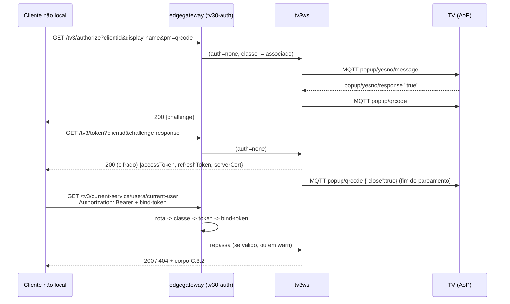
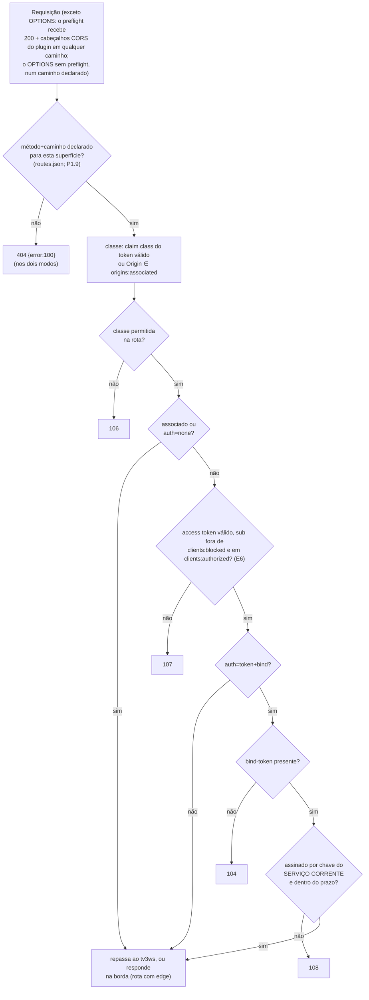
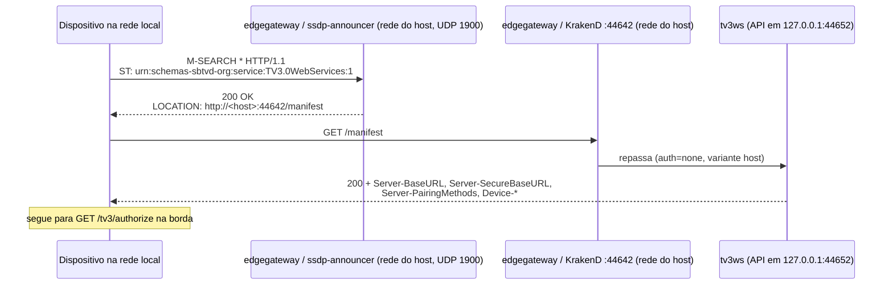

# Autenticação e validação de credenciais (TV 3.0)

> **Estado do código em 2026-10-12:** tv3ws + plugin `tv30-auth` da borda, depois das decisões da reunião de 05/10 com o Joel (D-0510-1 a D-0510-4 nesta página), de duas decisões do Luís em 10/10, a P1.3 (um nome de host por app de emissora) e a P1.9 (superfícies com rotas distintas), e das decisões do Luís em 11/10 que tocam esta página: a E6 (a borda exige o cliente em `clients:authorized`), a A4 (`POST /tv3/{serviceContextId}/users` fora da tabela de rotas), a B2 (`SSDP_ADVERTISE_HOST` obrigatório com o anúncio ligado) e a manutenção da E1, da E3 e da F-2 (C.6.7.8 e C.6.7.9 como estavam), e das decisões do Luís em 12/10 que tocam esta página: a 44643 fixa no host também na bridge, a C.6.15.5 só para o cliente local e, à tarde, as rotas 2.1 `GET` e `DELETE /tv3/remote-device/device/{handle}` também só para o cliente local. Inclui as correções de 12/10, à tarde, de defeitos achados pela auditoria: o pop-up do QR code e do PIN na tela até o fim do pareamento, parâmetro vazio contado como ausente em `/tv3/authorize` e `/tv3/token`, o desafio de uso único e as comparações de segredo em tempo constante.
>
> A versão anterior deste documento não correspondia ao código:
> - classificava o cliente pelo IP;
> - descrevia `POST /tv3/authorize` e `POST /tv3/token`, mas as duas rotas são `GET`;
> - dava um SSDP com `ST` e `LOCATION` que o código nunca usou.
>
> Onde este texto cita a norma, a seção é da ABNT NBR 25608 (Anexo C). Onde descreve mensageria, gateways ou o Redis, trata-se de decisão do projeto.

## Classes de cliente (P1)

A classe é decidida **uma vez**, na autorização (`GET /tv3/authorize`, em `tv3ws/src/api/client-identification/controller.ts`). Ela viaja no claim `class` do access token e nunca é reinferida a partir do endereço de rede.

| Classe (claim `class`) | Como é reconhecida | Credenciais nas APIs |
|---|---|---|
| `non-local` | `pm` (`qrcode` ou `kex`) presente no `/authorize` | access token; bind-token nas APIs protegidas. Fora de `/authorize` e do primeiro `/token`, a norma exige HTTPS (C.4.1.6, erro 106). No testbed, só o `/token` aplica isso hoje (renovação por HTTP dá 106); nas demais APIs, ninguém aplica desde a D-0510-1, porque a borda não tem TLS (L3). |
| `local-autonomous` | sem `pm`, e `Origin` fora de `origins:associated` | access token; bind-token nas APIs protegidas |
| `local-associated` | `Origin` presente no hash `origins:associated`, que o AoP grava (origem própria da app → id do serviço corrente: o valor de `aop/currentService`, o mesmo de `session:current-service-id`, ou `current-service` sem serviço) | nenhuma no próprio contexto (C.4.1.1) |

O reconhecimento do local associado pelo `Origin` é a lacuna L1. **Decidido pelo Luís em 03/10: fica como está, com o risco aceito.** Não houve mudança de comportamento. Os limites conhecidos:
- **Risco aceito:** fora do navegador, o `Origin` pode ser forjado, e um `Origin` forjado presente em `origins:associated` passa como associado;
- **origem própria por app (P1.3, decidida pelo Luís em 10/10: um nome de host por app).** Até 10/10, as apps de emissora eram servidas por proxy na origem do AoP e chegavam à borda com o `Origin` do AoP, enquanto o AoP gravava em `origins:associated` o alvo do proxy (`http://bcast:8081`): não eram reconhecidas como associadas (em `warn`, `X-TV30-Auth-Warn: 107`; em `enforce`, seriam bloqueadas). Desde 10/10, o AoP abre cada app na origem `http://<rótulo>.<APPS_DOMAIN>:<AOP_PUBLIC_PORT>` (padrão `<rótulo>.apps.localhost:8080`; `aop/src/app-hosts.js`), roteia pelo cabeçalho `Host` e grava essa origem ao lançar a app (`aop/src/core.js`); é o `Origin` que o navegador manda nas chamadas dela. Verificado na stack em 10/10 (`scripts/test-auth.sh`, em `enforce`). Desde 11/10 (decisões do Luís), o rótulo sai de um `appId` fixo por app (`urn-tv30-app-users-test`, por exemplo), e a URL leva o prefixo `/graphicsAppProxy`, que não entra no `Origin`. Até 11/10, a app aberta pelo caminho antigo `/graphicsAppProxy`, no host do AoP, ficava na origem do AoP e não era reconhecida; desde 11/10 esse caminho redireciona (302) para o host da app. Com a tela do AoP aberta de outra máquina, `*.localhost` não aponta para o AoP, e as apps não carregam (`APPS_DOMAIN` aceita um domínio resolvível na rede);
- a C.4.1.7 (p. 206; p. 224 do PDF) manda o associado usar uma porta de origem atribuída pelo gerenciador de componentes e diz, na mesma seção, que o mecanismo de diferenciação é decisão de implementação. O `Origin` é a decisão deste testbed.

## Emissão do access token (tv3ws)

### `GET /tv3/authorize?clientid=<uuid>&display-name=<nome>[&pm=qrcode|kex[&key=<pub ECDH>]]` (Tabela C.3)

1. O tv3ws publica um pop-up sim/não na TV pelo tópico `aop/display/layers/popup/yesno/message`, com timeout de 10 s (`client-identification/service.ts`).
2. Só a resposta `"true"` no tópico `.../yesno/response` autoriza: o cliente entra em `clients:authorized` (D-0510-4, ver abaixo) e ganha o registro `client:{id}`. A AoP publica `"false"` quando o espectador recusa e também quando o pop-up expira. Nesse caso, ou sem resposta em 10 s, o cliente vai para `clients:blocked` e a resposta é **102**. Até 02/10/2026, qualquer resposta não vazia autorizava, porque `Boolean("false") === true`.
3. **Local** (associado ou autônomo): a resposta é `{"refreshToken": ...}`.
4. **`clientid` já usado:** 101, para qualquer classe e sem pop-up, tanto para o cliente já autorizado quanto para o recusado (`clients:blocked`). As duas metades têm origens diferentes:
   - o 101 para o cliente já autorizado é decisão do Luís em 03/10 (D-L2; Tabela C.3, "if clientid has been used before", e C.6.1.4.4);
   - o 101 para o recusado segue a nota da Tabela C.3 ("any attempt to authorize immediately returns error 101, without displaying the authorization dialog", p. 233 do PDF). Era uma leitura da D-L2 feita na implementação e foi **confirmada na reunião de 05/10** (`docs/decisoes-pendentes.md` da raiz, *Confirmados na reunião de 05/10*).

   Até 03/10, o cliente local já autorizado recebia de novo o refresh token corrente, sem pop-up, e o bloqueado recebia 102.
5. **Não local:**
   - **`qrcode`:** depois do sim, a TV mostra um QR code com uma chave de 32 bytes. O segredo é SHA-256(chave)[0:16]. A resposta é `{"challenge": ...}`.
   - **`kex`:** ECDH P-256. A TV mostra um PIN igual a hash mod 10000, e o segredo é SHA-256(segredo ECDH)[0:16]. A resposta é `{"challenge": ..., "key": ...}`, com `key` = chave parcial do servidor (ponto SEC 1 sem compressão, base64url; Tabela C.3, formato 3, e C.4.3.4). Até a integração de 04/10 o código devolvia só `{challenge}`, e o pareamento por PIN não se completava. A correção é de conformidade (Tabela C.3, formato 3; C.4.3.3, passo 1) e foi **confirmada na reunião de 05/10**.
   - O `challenge` é uma string aleatória cifrada em AES-128-ECB com o segredo. O tv3ws guarda o SHA-256 dela em bytes (`generateChallenge`, em `client-identification/service.ts`).
   - **O pop-up do QR code e o do PIN ficam na tela até o fim do pareamento** (correção de 12/10, à tarde). O fim do pareamento é o `/tv3/token` que confere a solução do desafio com sucesso (abaixo): logo depois da resposta, o tv3ws publica `{"close":true}` no mesmo tópico do pop-up (`aop/display/layers/popup/qrcode` ou `.../pin`; `endPairing`, em `client-identification/service.ts`, e `closeQRCodePopUp`/`closePINPopUp`, em `tv3ws/src/core.ts`), e a camada gráfica fecha o pop-up daquele tipo (`handlePopupMessage`, em `aop/public/js/popup.js`). É o que pedem a C.4.3.2 ("When this stream ends, the pop-up with the QR code is removed from the receiver screen, which informs that the pairing has been successful", p. 210; p. 228 do PDF) e a C.4.3.3 ("the pop-ups for filling out the PIN are removed from both the non-local client's screen and the TV 3.0 receiver", p. 211; p. 229 do PDF). Trava de segurança: o pop-up vai com prazo de 120 s (`PAIRING_POPUP_TIMEOUT_MS`), e a página o fecha sozinha no fim dele, se o cliente desistir. O valor é decisão do projeto; a norma não fixa prazo. Até 12/10, o prazo era de 1000 ms, e o pop-up ficava cerca de 1 s na tela.
   - O `/tv3/token` que falha não fecha o pop-up, e não há caminho em que o pareamento falhe de vez: o desafio errado dá 102 e a tentativa continua aberta (PENDENTE (Joel), abaixo). O fim do pareamento de um cliente só fecha o pop-up se ele ainda for o desse cliente (em memória). Desde a noite de 12/10 (decisão do Luís; G2), o pop-up de outro cliente não toma mais o lugar dele: um `/tv3/authorize` novo recebe 103 enquanto houver na tela um sim/não esperando resposta, ou o QR code ou o PIN de um pareamento (`reservarCamada`, em `client-identification/service.ts`; C.4.2.3). A camada libera no fim do pedido, no sucesso do pareamento ou no fim da trava de 120 s. O aviso da C.6.14.5 (G9) continua esperando numa fila própria.

Erros possíveis no `/authorize`:

| Código | Situação |
|---|---|
| 105 | Falta `clientid`, `display-name` ou `key` (no `kex`). Desde 12/10 (correção), parâmetro vazio ou só com espaços conta como ausente (`queryParam`, em `client-identification/controller.ts`; Tabela C.3, p. 215; p. 233 do PDF). Antes, `clientid=` vazio autorizava o `clientid` `""`, `display-name=` vazio passava, e `key=` vazio no `kex` dava 404 `{"error":200}`. |
| 101 | `pm` não suportado, ou `clientid` já usado (autorizado ou bloqueado), para qualquer classe. Desde 12/10, `pm=` vazio vale como ausente, e o cliente se classifica local (antes, 101). |
| 102 | O espectador recusou no pop-up (ou o pop-up expirou). |
| 103 | Desde 12/10, à noite (decisão do Luís; G2): a camada gráfica está ocupada pelo sim/não de outro pedido, ou pelo QR code ou o PIN de um pareamento (C.4.2.3; Tabela C.3, "When the TV 3.0 receiver is unable to display the authorization pop-up"). Vale também para o mesmo `clientid`. Vem depois do 105 e do 101, antes do pop-up. |

### `GET /tv3/token?clientid=<uuid>&(challenge-response=<...>|refresh-token=<...>)` (Tabela C.4)

- **Resposta:** `{"accessToken", "tokenType": "Bearer", "expiresIn", "refreshToken"}`. O refresh token é rotacionado a cada chamada.
- **Primeiro acesso do não local** (por HTTP, com `challenge-response`): a resposta vem cifrada (`application/octet-stream`) e inclui `serverCert`.
- **Com os dois parâmetros,** vale o `refresh-token`. Desde 12/10 (correção), parâmetro vazio ou só com espaços conta como ausente (Tabela C.4, 105, p. 217; p. 235 do PDF), e um dos dois ramos sempre roda. Antes, `refresh-token=` ou `challenge-response=` vazio não caía em nenhum ramo e a credencial saía sem conferência nenhuma: o cliente autorizado recebia accessToken e refresh token novos (o legítimo passava a dar 101), e o não local, por HTTP, pulava o pareamento e a exigência de HTTPS.
- **O desafio vale uma vez** (correção de 12/10). No `challenge-response` conferido, o tv3ws tira do cliente o material do pareamento (challenge, chave simétrica e par ECDH) no mesmo trecho síncrono da conferência (`takePairingMaterial`, em `tv3ws/src/modules/auth-manager/client.ts`), e dois `/tv3/token` simultâneos com a mesma resposta não passam os dois. A Tabela C.4 permite descartar a chave depois do primeiro acesso ("In subsequent accesses, the use of the symmetric encryption key is no longer necessary and it can be discarded", p. 217-218; p. 235-236 do PDF). Se a emissão falhar depois da conferência, o material volta ao cliente e a tentativa segue aberta. Antes, a mesma resposta ao desafio emitia credencial de novo a cada chamada (e, por HTTPS, em claro), rotacionando o refresh token do cliente legítimo. O material do pareamento vive só na memória do tv3ws: um reinício o perde.
- **Comparações em tempo constante** (correção de 12/10): o refresh token e a resposta ao desafio são comparados com `crypto.timingSafeEqual` sobre os bytes (`safeEqual`, em `tv3ws/src/util/encryption.ts`), e tamanhos diferentes são falha. A resposta decifrada é comparada em bytes com o SHA-256 guardado; antes, os dois lados passavam por `.toString()` UTF-8, e bytes que não formam UTF-8 válido viravam U+FFFD (duas respostas diferentes podiam passar como iguais). `refresh-token` repetido na URL (lista) não vale (101). O formato do que o cliente manda não mudou.

Erros possíveis no `/token`:

| Código | Situação |
|---|---|
| 105 | Falta `clientid`, ou faltam os dois: `challenge-response` e `refresh-token`. Vazio ou só com espaços conta como ausente (desde 12/10). |
| 102 | Cliente fora de `clients:authorized` (nunca autorizado, ou bloqueado depois); `challenge-response` errado, inclusive o que decifra para um tamanho diferente do hash e, desde 12/10, o que não decifra (tamanho ou *padding* inválido no AES-128-ECB, ou o parâmetro repetido na URL), que antes dava 404 `{"error":200}` por exceção; e, desde 12/10, `challenge-response` sem desafio pendente: repetido depois do sucesso, de cliente local ou depois de um reinício do tv3ws (Tabela C.4: "If the challenge-response value is not validated by the TV 3.0 receiver as correct"). |
| 106 | Cliente não local com `refresh-token` por HTTP. |
| 101 | `refresh-token` que não pertence ao cliente. |
| 200 | Falha da plataforma (Redis fora do ar, por exemplo) e exceção no tratamento: 404 `{"error":200}` pelo `errorHandler`. |

### O access token

- **Formato:** JWT HS256 assinado com `JWT_SECRET`.
- **Claims:** `iat`, `nbf`, `exp` (24 h), `iss` (igual a `JWT_ISSUER`, padrão `GenericIssuer`), `sub` (o `clientid`) e `class`. Ver `tv3ws/src/modules/auth-manager/manager.ts`.
- **Estado no Redis** (escrito só pelo tv3ws, `tv3ws/src/modules/auth-manager/manager.ts`):
  - `client:{id}`: HASH com `class`, `refreshToken` e `accessToken`;
  - `clients:authorized`: SET dos autorizados (D-0510-4, reunião de 05/10 com o Joel);
  - `clients:blocked`: SET dos recusados ou bloqueados.

**Autorizados e bloqueados (D-0510-4).** Os dois conjuntos são disjuntos: autorizar e bloquear são uma função do Redis cada (`tv30_cliente_autoriza` e `tv30_cliente_bloqueia`, desde o P4, decidido pelo Luís em 10/10; antes, transações `MULTI`), que tira o id de um e o põe no outro. O `/tv3/token` só emite para quem está em `clients:authorized`, então o cliente bloqueado depois de autorizado não obtém mais token, como pede a C.4.2.2 ("it is not able to request the access token", p. 208; p. 226 do PDF). No boot, o tv3ws inclui em `clients:authorized` os `client:{id}` anteriores ao conjunto que não estão bloqueados. As funções `listAuthorizedClients` e `listBlockedClients` são a base da tela de histórico de autorizações que a C.4.2.2 pede ao receptor; a tela não existe. A borda recusa com 107 o `sub` em `clients:blocked` e, desde 11/10 (E6, decisão do Luís; `docs/decisoes-pendentes.md` da raiz), também o `sub` fora de `clients:authorized` e o token sem `sub` (`edgegateway/plugin/handler.go`, `evaluate`). Até 11/10, ela conferia só `clients:blocked`, e um cliente desbloqueado à mão, fora dos dois conjuntos, voltava a passar.

## Validação na borda (plugin `tv30-auth`)

**Decisão de 28/09 (D1):** toda a validação de credenciais fica na borda, num plugin Go do KrakenD carregado nas duas superfícies do `edgegateway`. O tv3ws só implementa as APIs.

**Reunião de 05/10 com o Joel (D-0510-1): o tv3ws fica "anônimo"**, só recebe e responde. Até ali, ele ainda tinha duas validações próprias, ativas nos dois modos: o middleware `authorization.ts` (107 a token presente e inválido) e o 106 por protocolo em `basic.ts` (cliente não local por HTTP). As duas saíram. Sob `/tv3`, o tv3ws só negocia a versão (`Accept-Version`) e emite a credencial (`/tv3/authorize`, `/tv3/token`). O 106 por protocolo não foi para a borda, que não tem TLS (L3): hoje ninguém o aplica fora do `/tv3/token`.

Os comportamentos provisórios das lacunas (L2, L4, L5) e o reconhecimento do associado pelo `Origin` (L1, decidido em 03/10 com o risco aceito) valem nos **dois** modos: em `warn` só registram e marcam `X-TV30-Auth-Warn`; em `enforce` bloqueiam ou liberam. Em `enforce`, um `Origin` forjado fora do navegador, presente em `origins:associated`, dispensa as credenciais (L1). É o risco aceito.

Toda resposta da borda leva `Access-Control-Allow-Origin: *` (C.4.1.9.2), também sem `Origin` na requisição. O `OPTIONS` que não é preflight, num caminho declarado, recebe 200 com `Access-Control-Allow-Origin`, `Access-Control-Allow-Methods` e `Access-Control-Allow-Headers` (C.4.1.9.3). O preflight (`OPTIONS` com `Access-Control-Request-Method`) recebe o mesmo, mais `Access-Control-Max-Age`, em qualquer caminho e com a lista pedida em qualquer ordem: desde 12/10 (decisão do Luís, opção b) quem o responde é o plugin, e não mais o módulo CORS do KrakenD, que recusava a lista fora de ordem.

### Política por rota

A política está em `edgegateway/routes.json`, nos campos `auth` (`none`, `token` ou `token+bind`) e `classes`. A regra das rotas `token+bind` é o campo "Security requirements" = *shall* de cada API na norma.

| Rotas | auth | classes |
|---|---|---|
| `/health`, `/manifest` | none | todas |
| `/tv3/authorize`, `/tv3/token` | none | autônomo, não local |
| `POST` e `DELETE /tv3/bind-context` (respondidas pela borda) | none | associado |
| `GET /tv3/bind-context` (respondida pela borda) | token | autônomo, não local |
| `GET /tv3/api-info` e `GET /tv3/api-info/{apiId}` (respondidas pela borda) | token | todas |
| APIs de usuários (C.6.14), `apps/{appid}/files` (C.6.4), `POST sensory-effect-renderers/{id}` (C.6.16.3) | token+bind | todas |
| `GET /tv3/remote-device/devices/{classId}` (C.6.15.5, desde 12/10); `GET` e `DELETE /tv3/remote-device/device/{handle}` (2.1, desde 12/10, à tarde) | token | associado, autônomo |
| demais | token | todas |

`POST /tv3/{serviceContextId}/users`, variante do testbed fora da norma (que só define `POST /tv3/current-service/users`, C.6.14.1), saiu da tabela em 11/10 (A4, decisão do Luís): a borda responde 100 a ela, com qualquer scid. Até ali, estava como `token+bind`.

`GET /tv3/remote-device/devices/{classId}` (C.6.15.5) é só do cliente local desde 12/10 (decisão do Luís): a Tabela C.78 (p. 339; p. 357 do PDF) diz "This API allows a local client application". Até ali, admitia todas as classes.

`GET` e `DELETE /tv3/remote-device/device/{handle}`, as rotas da versão 2.1 (C.6.15.6 e C.6.15.7 da proposta 2.1 do Luís ao Fórum, fora da Tabela C.2 e sem campo `api`), seguem a C.6.15.5 desde a segunda decisão do Luís em 12/10. O próprio tv3ws as descreve como de uso do cliente local (`tv3ws/src/api/multi-device/index.ts`: "This API allows a local client application to establish communication with a remote device"). Até ali, não tinham `classes`: pela política, um não local com access token e um *handle* conhecido abria o ponto de entrada local daquele aparelho, inclusive pela 44643 (lido no código, não medido).

A tabela completa está em `edgegateway/plugin/README.md`.

**Superfície de cada rota (P1.9, decisão do Luís em 10/10).** As `classes` também decidem em que superfície a rota existe (`edgegateway/generate.js`, `SURFACE_RULES`): a externa (44643) só tem as rotas que admitem `non-local`, e a interna (44642) tem todas. Pela tabela acima, ficam fora da externa `POST` e `DELETE /tv3/bind-context`, desde 12/10 `GET /tv3/remote-device/devices/{classId}` e, desde a tarde de 12/10, `GET` e `DELETE /tv3/remote-device/device/{handle}`; lá elas dão 100 na etapa de rota, antes da classe, como qualquer caminho não declarado. A externa tem 21 rotas, e a interna, 26. Na 44642, o não associado continua recebendo 106 nas duas da C.6.8, e o não local, 106 na C.6.15.5 e nas duas rotas 2.1 (em `warn`, só o aviso). A Tabela C.78 lista 107 para o não local na C.6.15.5, e a C.4.1.8, 106 para o não local numa API de uso exclusivo do cliente local: o código exato fica com o Joel (PENDENTE, abaixo).

### Bind-token (C.4.1.3, C.4.1.4, C.6.8)

- **Quem emite:** o receptor **não emite** bind-token. Quem emite é a emissora (A.4.9, C.6.15.4).
- **Registro da chave:** o local associado registra `{alg, key}` em `POST /tv3/bind-context`. Desde a reunião de 05/10 com o Joel (D-0510-2, que resolveu o A3), quem responde é a própria borda (`edgegateway/plugin/bindcontext.go`), e não mais o tv3ws, com o mesmo contrato. A chave vai para a LIST `bind-context:{serviceId}`, onde `serviceId` é o valor de `session:current-service-id` no momento do registro. O registro e a validação usam a mesma função de leitura de chave (`plugin/keys.go`).
- **Consulta:** `GET /tv3/bind-context`, com o bind-token no cabeçalho `bind-token` (C.6.8.3), também na borda. Ela procura entre as chaves de **todos** os serviços (`SCAN bind-context:*`) e lista os que validam o token.
- **Revogação:** `DELETE /tv3/bind-context`, com o cabeçalho `key`, também na borda.
- **Validação na borda,** em quatro frentes e nesta ordem:
  1. formato JWT;
  2. assinatura;
  3. `nbf` e `exp`;
  4. `iat`.
- **Regras da assinatura:**
  - Algoritmos aceitos: HS256, HS512, RS256 e RS512 (C.4.1.4.8). `none` é sempre inválido.
  - O token tem de ter o mesmo `alg` da chave registrada.
  - Basta que **qualquer** chave registrada para o **serviço corrente** valide. O token de uma emissora não vale no contexto de outra (isolamento, D4).

### Modo e erros

- **`AUTH_ENFORCE=warn`** (padrão): nenhuma falha de credencial é bloqueada; o 100 (rota não declarada) e o 200 (panic do roteador) valem nos dois modos. A borda loga `[tv30-auth] WARN code=...` e acrescenta `X-TV30-Auth-Warn: <código>` à resposta. O motivo é que clientes como o Guaraná ainda não obtêm token.
- **`AUTH_ENFORCE=enforce`:** bloqueia com status 404 e corpo `{"error": <n>, "description": "..."}` (C.3.2), com `Access-Control-Allow-Origin: *`.
- **Redis fora:** na decisão de credencial, em `warn` passa, e em `enforce` responde `{error: 200}`. Na C.6.8, que a borda responde, a falha do Redis dá `{error: 200}` nos dois modos.
- **APIs respondidas pela borda** (C.6.8, C.6.7.8 e C.6.7.9): os erros da própria API (101, 104, 105, 108, 300 e os da negociação de versão) saem nos dois modos, porque não são decisão de credencial. O contrato completo está em `edgegateway/plugin/README.md`, seção *APIs respondidas pela borda*.

### PENDENTE (Joel)

Os comportamentos provisórios estão marcados no código e listados em `edgegateway/plugin/README.md`. A L1 (reconhecer o associado pelo `Origin`) saiu desta lista: foi decidida pelo Luís em 03/10, com o risco aceito (seção *Classes de cliente*).
- **L2:** `{serviceContextId}` constante no tv3ws;
- **L3:** sem TLS na borda, e portanto sem 106 por protocolo (o tv3ws, que o aplicava, deixou de aplicar com a D-0510-1);
- **L4:** 106 ao associado em `/authorize` e `/token` só em `enforce`;
- **L5:** relógio do host em vez do System Time Fragment;
- **L7:** liberação de recursos ao revogar uma chave;
- **H1:** associado em contexto de outra emissora: a borda não confere, para o associado, o `{serviceContextId}` do caminho (C.4.1.1);
- **H2:** sem serviço corrente, 108 nas rotas `token+bind`, onde a maioria das tabelas prevê 300;
- **C.6.7.8 e C.6.7.9** (rodada de 05/10): a versão de cada API é 2.0 em todas (a remote-device aceita 2.1, e não foi decidido se aparece assim; E2). Os outros dois pontos foram mantidos pelo Luís em 11/10: id da Tabela C.2 que o testbed não implementa dá 101 (E1), e, sem `subsystem`, a C.6.7.9 lista todas as APIs (E3). No código, estão marcados `DECIDIDO (Luis, 11/10; E1)` e `DECIDIDO (Luis, 11/10; E3)` (`edgegateway/plugin/apiinfo.go`);
- **100 ou 106 na 44643 com TLS** (P1.9, ligado à L3): a C.4.1.8 (p. 206-207; p. 224-225 do PDF) manda responder 106 ao não local que chama por HTTPS uma API exclusiva do cliente local, e `POST`/`DELETE /tv3/bind-context` dão 100 na 44643. Enquanto ela for HTTP, a C.4.1.8 não se aplica ao pé da letra; a mesma seção diz que a C.6.1.2 (`/tv3/authorize`) só se acessa por HTTP, e a regra a mantém na 44643, porque ela admite o não local. Desde 12/10 (decisão do Luís), entra neste ponto (F-1: item 1 do P1.9 na seção F de `docs/decisoes-pendentes.md` da raiz) o código da C.6.15.5 para o não local: a borda dá 100 na 44643 e 106 na 44642, e a Tabela C.78 (p. 339; p. 357 do PDF) lista 107 ("If invoked from a non-local client"). As rotas 2.1 de `/device/{handle}` recebem o mesmo desde a tarde de 12/10; se o código delas entra na F-1 também está com o Joel (o texto da proposta 2.1 não está no repositório);
- **Lista de APIs por superfície** (P1.9): a externa lista 17 APIs, sem as duas da C.6.8 restritas ao associado e, desde 12/10, sem a C.6.15.5, só do cliente local (as três dão 101 lá). As rotas 2.1 não têm campo `api` e não mudam a lista. A Tabela C.46 (p. 301 do PDF) fala em "all APIs of a given category", sem superfície. **Decidido pelo Luís em 11/10 (F-2): cada superfície lista só as APIs que oferece**, como já estava; no código, `DECIDIDO (Luis, 11/10; F-2)` (`edgegateway/generate.js`, `pluginConfig`).

Também aberto pela rodada de 05/10, sem marcador no código da borda: o que a futura tela da C.4.2.2 faz no desbloqueio (E5 de `docs/decisoes-pendentes.md` da raiz). A E6, exigir `clients:authorized` na borda, foi decidida pelo Luís em 11/10: exigir (seção *Emissão do access token*, acima).

Abertos pelas correções de 12/10 no pareamento (tv3ws; seção *Achados de 12/10* de `docs/decisoes-pendentes.md` da raiz):
- **o desafio errado deve encerrar a tentativa de pareamento?** Hoje o 102 do desafio errado deixa a tentativa aberta: o material do pareamento fica no cliente, o mesmo challenge pode ser respondido de novo e o pop-up só sai no sucesso ou pela trava de 120 s. A Tabela C.4 só diz que o 102 significa "the pairing was not successfully concluded". Marcado `PENDENTE (Joel)` em `tv3ws/src/api/client-identification/service.ts`;
- **o challenge não expira** (G2). O challenge pendente vale até o sucesso ou até o tv3ws reiniciar, sem prazo; a trava de 120 s fecha o pop-up e libera a camada, mas não o invalida. A outra parte da G2, o pedido novo com a camada ocupada, o Luís decidiu em 12/10, à noite: 103 (acima). O aviso da C.6.14.5 (`aop/display/layers/popup/info`, G9) espera numa fila só dele ([08](08-mqtt-map.md)).

**Redis sem senha e publicado no host (6379): decidido pelo Luís em 03/10.** A conexão com o banco fica como está, sem senha; só a interface administrativa (redis-commander) passou a exigir login. O risco continua: quem alcança a porta grava chaves de bind ou origens associadas e contorna a borda em `enforce` (ver `KNOWN-ISSUES.md` da raiz).

## Descoberta SSDP

**Código:** `edgegateway/ssdp/` (o anunciante da borda, em Go, só com a biblioteca padrão: `main.go` com o laço de anúncio, a política de falha e o byebye; `config.go` com o host e as portas anunciados; `iface.go` com a interface do anúncio; `ssdp.go` com as mensagens; testes em `ssdp_test.go` e, com rede falsa, em `main_test.go`), `edgegateway/entrypoint.sh` (sobe e vigia o anunciante) e `tv3ws/src/manifest.ts` (`GET /manifest`, registrado no app Express do tv3ws), com o host e as portas do `tv3ws/src/ssdp-config.ts`. O tv3ws rodando sozinho no host (dev-host) ainda anuncia com `tv3ws/src/ssdp-server.ts` e `tv3ws/src/ssdp-interface.ts`, com a biblioteca `@lvcabral/node-ssdp`.

**Onde roda (L6, opção A; decidido pelo Luís em 09/10):** o anúncio sai da **borda**. O anunciante é o binário `/usr/local/bin/ssdp-announcer` da imagem `tv30-edgegateway`, compilado no estágio `ssdp` do `edgegateway/Dockerfile` depois de `go vet` e `go test`. O `entrypoint.sh` só o sobe com `SSDP_ENABLED=true` (padrão desligado). Quem liga é o override `docker-compose.ssdp.yml` da raiz do TV30, que põe a borda em `network_mode: host`, com `EDGE_VARIANT=host` (backends `http://127.0.0.1:44652` e `https://127.0.0.1:44653`, em `edgegateway/routes.json`) e `REDIS_HOST=127.0.0.1`, e publica a 44652/44653 do tv3ws só em `127.0.0.1`. O tv3ws da bridge recebe `SSDP_ENABLED: "false"` e não anuncia. Fora do compose, `SSDP_ENABLED` vale ligado, e o tv3ws rodando sozinho no host anuncia por conta própria. A opção A substituiu a opção B (decidida em 04/10, informado pelo Luís): o container `tv3ws-ssdp`, com a imagem do tv3ws em rede do host, e a borda e o tv3ws na `ginga_net`. A descoberta só é suportada em Linux nativo com Docker Engine (decisão do Joel, informada pelo Luís em 04/10). A norma não diz onde o anunciante roda (C.3.4) nem em que plataforma; as duas coisas são decisões do projeto.

- **Anúncio:** em UDP 1900, a cada 10 s, o serviço `urn:schemas-sbtvd-org:service:TV3.0WebServices:1` e o UDN, com o mesmo formato do anunciante anterior (`USN` `<UDN>::<URN>`). A resposta ao M-SEARCH sai com `CACHE-CONTROL: max-age=1800`, igual ao NOTIFY (até a opção B, `max-age=4`). Sai só pela interface IPv4 que tem o IP do host anunciado. Se o host não for um IP da máquina, sai pela interface da rota padrão, com aviso no log. `SSDP_INTERFACE` força a interface. Sem nenhuma interface possível, o anunciante espera a rede (ver *Falha do anúncio*, abaixo).
- **`LOCATION`:** `http://<host>:44642/manifest`, a superfície interna da **borda** (D10). Não aponta para a porta interna do tv3ws.
- **Como o `<host>` é escolhido:** na borda, desde 11/10 (B2, decisão do Luís), é o `SSDP_ADVERTISE_HOST`, obrigatório com o anúncio ligado; ausente, vazio ou sem host é erro de configuração (`edgegateway/ssdp/config.go`), e o `preflight` da raiz do TV30 já para a subida sem ele. O `SERVER_URL` e o IP local deixaram de ser fonte do host do anúncio. No tv3ws, a regra do `/manifest` não mudou: `SSDP_ADVERTISE_HOST`, senão `SERVER_URL`, senão o IP local (`tv3ws/src/ssdp-config.ts`). Até 11/10, a borda seguia a mesma cadeia do tv3ws, escrita em Go e em TypeScript, sem teste cruzado entre as duas. No compose da raiz, com o override, a borda e o tv3ws leem o `SSDP_ADVERTISE_HOST` dos mesmos arquivos de ambiente: `tv3ws/.env` e depois o `.env` da raiz, que prevalece. Como ele é obrigatório, o `LOCATION` e o `Server-BaseURL` do `/manifest` saem do mesmo host. Com a opção B, isso foi medido em 04/10 (`docs/ssdp-verificacao.md` da raiz, teste 16), e a ordem `tv3ws/.env` → `.env` da raiz foi conferida com `docker compose config`; com a opção A, foi medido em 09/10 (testes 34 e 41: o `/manifest` devolve o mesmo host do `LOCATION`). Com o tv3ws rodando no host, fora do compose, isso não é garantido (`docs/dev-local.md` da raiz).
- **Portas:** as anunciadas são as da borda, 44642 e 44643. `EDGE_HTTP_PORT` e `EDGE_HTTPS_PORT` mudam só o que é anunciado (no `LOCATION` e no `/manifest`), e não as portas em que o KrakenD escuta, fixas em `edgegateway/routes.json` (`surfaces.*.port`). Com o override, a borda está em rede do host, e as duas são as do host. Na bridge, desde 12/10 (decisão do Luís), a 44643 sai fixa na mesma porta do host por padrão (`EDGE_EXT_PUBLISH=44643:44643`, em `docker-compose.yml` desta pasta), porque o `Server-SecureBaseURL` do `/manifest` anuncia `<host>:44643` e o tv3ws não sabe a porta que o Docker escolheria. De 11/10 (C1) a 12/10, ela saía numa porta de host escolhida pelo Docker, que o `/manifest` não anunciava; `EDGE_EXT_PUBLISH=44643` (só o número) ainda faz isso. Outra porta de host fixa pede o mesmo número no `EDGE_HTTPS_PORT`.

`GET /manifest` (rota `auth=none` na borda) responde 200; o corpo não carrega informação (o Express manda o texto `OK`). A informação vai nos cabeçalhos:
- `Server-BaseURL` (`<host>:44642`);
- `Server-SecureBaseURL` (`<host>:44643`). **Atenção:** a 44643 da borda ainda é HTTP puro (L3), então esse endereço "seguro" não aceita `https://`. PENDENTE (Joel): o que anunciar aqui até a decisão da L3 (a porta da borda, como hoje, ou o HTTPS do próprio tv3ws, que não é publicado no host);
- `Server-PairingMethods` (`qrcode,kex`);
- `Device-BrandName`, `Device-Model` e `Device-FriendlyName`.

Desde 11/10 (B3, decisão do Luís), o `/manifest` também manda `Access-Control-Expose-Headers` com os seis nomes (`tv3ws/src/manifest.ts`), para o navegador entregá-los a um script de outra origem. Pela borda, o plugin acrescenta outra linha do mesmo cabeçalho (`Content-Length`, `X-TV30-Auth-Warn`, do `cors.expose_headers` do `routes.json`; até 12/10, era o módulo CORS do KrakenD), sem apagar a do tv3ws.

**Falha do anúncio.** O morre-inteiro foi decidido pelo Luís em 09/10 e revisto por ele em 10/10: "derrubar a borda só em erro de configuração e tolerar a falta de rede com novas tentativas". O `entrypoint.sh` vigia o anunciante junto com os dois KrakenD e o httpd da documentação: se ele sai, a **borda inteira cai, com todas as APIs**, e o `restart: unless-stopped` a traz de volta. Na opção B, só o `tv3ws-ssdp` caía. O que a decisão de 10/10 mudou é quando o anunciante sai (`edgegateway/ssdp/main.go`):
- **Erro de configuração: sai com 1** e o log `[ssdp] FALHA em ...` (D9). São o `SSDP_ADVERTISE_HOST` ausente, vazio ou sem host (desde 11/10, B2), a porta inválida em `EDGE_HTTP_PORT`/`EDGE_HTTPS_PORT`, `SSDP_INTERFACE` com um nome que não existe na máquina (ou a de loopback), conferida na partida, o bind da 1900 recusado por um socket sem `SO_REUSEADDR` (`EADDRINUSE`) e qualquer erro que não seja de rede.
- **Falta de rede: não sai.** São nenhuma interface com IPv4, nenhuma rota padrão, a interface de `SSDP_INTERFACE` sem IPv4 e o erro de rede ao abrir os sockets, ao enviar ou ao ler (`ENETUNREACH`, `EHOSTUNREACH`, `ENETDOWN`, `EHOSTDOWN`, `EADDRNOTAVAIL` e `ENODEV`, ou qualquer erro de socket depois que o IPv4 escolhido saiu da interface). O anunciante fecha os sockets, e não anuncia nem responde a buscas. Registra um `[ssdp] AVISO sem rede ...` ao entrar no estado e um `[ssdp] rede de volta ...` ao sair, sem repetir a cada tentativa, e tenta de novo com espera crescente (1, 2, 4, 8, 16 e 30 s, e daí a cada 30 s), escolhendo de novo a interface e o IPv4 de origem. O host do `LOCATION` é o `SSDP_ADVERTISE_HOST`, conferido uma vez, na partida, e não muda com a rede (B2, decidida pelo Luís em 11/10); se o IPv4 configurado não estiver mais em nenhuma interface, o anúncio sai pela da rota padrão, com aviso. Até 11/10, sem `SSDP_ADVERTISE_HOST` nem `SERVER_URL`, o host vinha do IP local e era recalculado a cada tentativa. Os avisos do anúncio só se repetem quando mudam.
- No tv3ws rodando sozinho com `SSDP_ENABLED` ligado (dev-host), nada mudou: qualquer falha do anúncio encerra o processo inteiro (`tv3ws/src/ssdp-server.ts`).

No SIGTERM, o `entrypoint.sh` para o anunciante primeiro, e ele envia `ssdp:byebye` (sem rede, sai sem byebye, porque não há socket). Ao começar a anunciar, registra-se `[ssdp] AVISO` quando o host anunciado é de loopback, quando `EDGE_HTTP_PORT` difere de 44642 (a C.3.4 fixa 44642 no `Server-BaseURL`) e, enquanto a L3 estiver aberta, que o `Server-SecureBaseURL` aponta para porta sem TLS.

**L6, decidida em 04/10 (opção B, informado pelo Luís) e re-decidida pelo Luís em 09/10 (opção A).** Medido em 02/10 (`docs/ssdp-verificacao.md` na raiz do TV30), com o arranjo anterior às duas: o NOTIFY do tv3ws aparecia na `eth0` do container e na bridge, e **não saía** da `eth0` da VM do WSL. Com a opção B, a descoberta por outro dispositivo da LAN foi validada num Linux nativo em 09/10 (testes 28 a 32). Com a opção A, também, no mesmo dia (testes 40 a 43, com um notebook no mesmo Wi-Fi).

**B2, decidida pelo Luís em 11/10:** com o anúncio ligado, o `SSDP_ADVERTISE_HOST` é obrigatório (acima). Até 11/10, o padrão do compose era `localhost` (`SERVER_URL`), e com esse valor o `LOCATION` e o `Server-BaseURL` só funcionavam na própria máquina (o boot avisava). As opções eram cair no IP local quando o `SERVER_URL` fosse loopback ou exigir o `SSDP_ADVERTISE_HOST`; ficou a segunda. Consequência: o `LOCATION` não acompanha troca de rede. Sem o anúncio, o `/manifest` do tv3ws ainda cai no `SERVER_URL`.
