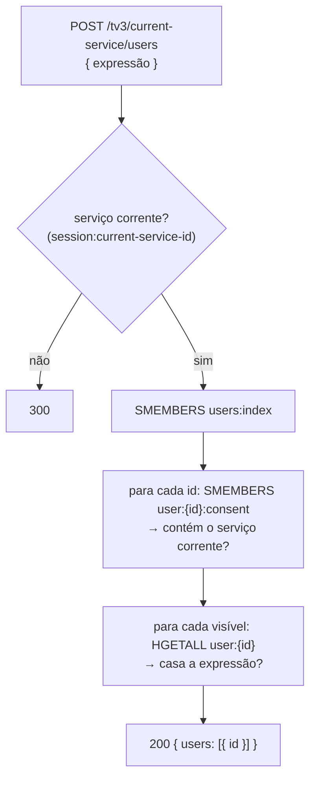
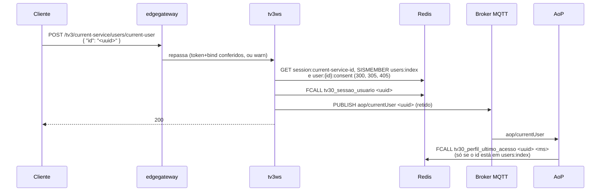

# Usuários e perfis — TV 3.0

> Onde o texto cita a norma, a seção e a tabela são da ABNT NBR 25608. Redis, MQTT e o gestor de perfis no AoP são decisões deste testbed.

## Base normativa

A seção 8.7 (Profile Manager) organiza os atributos do perfil do telespectador em três níveis (Figura 5):

| Nível | O que a norma diz | No testbed |
|---|---|---|
| **Atributos básicos** | Padronizados (Tabela 7); acessíveis pelo fabricante e pelo serviço de TV digital habilitado pelo espectador | `user:{id}` no Redis |
| **Atributos do dispositivo** | Definidos pelo fabricante (ou pelo desenvolvedor do AoP), que gerencia o acesso a eles | não há |
| **Atributos de emissora** | Definidos por cada serviço de TV digital, guardados no contexto daquele serviço e acessíveis só de dentro dele | `user:{id}:broadcaster-attrs:{scid}`, gravados pela C.6.14.5 |

### Tabela 7 e o que o testbed grava

| Atributo | Norma: tipo e uso | Testbed: regra do `esquema.json` e padrão do AoP na criação |
|---|---|---|
| `id` | UUID string, required; atribuído pelo AoP, não editável | UUID estrito (versão 1 a 8 e variante RFC 9562); o AoP usa `crypto.randomUUID()` |
| `nickname` | string até 20 caracteres, required (se o espectador não define, o AoP dá um valor único, por exemplo "Viewer 1") | texto de 1 a 20 caracteres, obrigatório; o formulário do AoP exige o campo |
| `parentalControl` | `true` ou `false`, required (padrão `false`) | `"true"` ou `"false"`, obrigatório |
| `maxContentRating` | valores predefinidos do país ou território; required só se `parentalControl = true` | `L`, `10`, `12`, `14`, `16` ou `18` (classificação indicativa do Brasil, escolha do testbed), obrigatório se `parentalControl` for `"true"` |
| `avatar` | file path, optional ("Path indicating the file with the graphical representation of the viewer profile") | o nome de um arquivo do diretório de miniaturas (`<USER_DATA_PATH>/thumbs` = `USER_THUMBS`), sem diretório, com extensão `.svg`, `.png`, `.jpg`, `.jpeg` ou `.webp` (tipo `nomeArquivo`); o AoP grava o SVG do formulário em `<id>.svg` e põe esse nome no campo, e a carga traz `c3167a18-5dc5-4a6e-9b1d-3f2a7c5e8d10.svg` |
| `audioLanguage` | string IETF RFC 5646, optional | formato RFC 5646; o AoP grava `pt-BR` se o campo vier vazio |
| `closedCaptioningLanguage` | string IETF RFC 5646, optional; aplicável só se `closedCaptioning = true` | formato RFC 5646; o AoP só grava com `closedCaptioning` ligado (padrão `pt-BR`) |
| `userInterfaceLanguage` | string IETF RFC 5646, optional | formato RFC 5646; o AoP grava `pt-BR` se o campo vier vazio |
| `closedCaptioning` | `true` ou `false`, required (padrão `false`) | `"true"` ou `"false"`, obrigatório |
| `closedSigning` | `true` ou `false`, required (padrão `false`) | `"true"` ou `"false"`, obrigatório |
| `closedSigningSide` | `left` ou `right`, required (padrão `right`); aplicável só se `closedSigning = true` | obrigatório se `closedSigning` for `"true"`; o AoP grava `right` se o campo vier vazio |
| `closedSigningWidth` | inteiro de 14 a 28, required (padrão 28); aplicável só se `closedSigning = true` | inteiro de 14 a 28, obrigatório se `closedSigning` for `"true"`; o AoP grava 28 se o campo vier vazio |
| `audioDescription`, `dialogEnhancement`, `voiceGuidance` | `true` ou `false`, required (padrão `false`) | `"true"` ou `"false"`, obrigatórios |

Fora da Tabela 7, o testbed grava `lastAccess` (instante em ms) na troca de usuário corrente. No máximo cinco perfis (10.3.3), conferidos pela função `tv30_perfil_grava` na mesma operação da gravação (`maxMembros` de `users:index` no `esquema.json`): a criação do sexto é recusada, sem despejo.

## Quem cuida dos perfis

A dona de `users:index`, `user:{id}` e `user:{id}:consent` é a plataforma, o AoP. O tv3ws só lê essas chaves. Toda escrita passa pelas funções do Redis, que conferem o esquema da Tabela 7:

| Operação | Quem | Função do Redis |
|---|---|---|
| Criar perfil (formulário do AoP; com cinco perfis, a função recusa o sexto e o AoP responde 400; grava antes o arquivo do avatar, `<USER_DATA_PATH>/thumbs/<id>.svg`, e o apaga se o perfil for recusado) | AoP, `createProfile` | `tv30_perfil_grava` |
| Perfil padrão (com `users:index` vazio, na partida e ao abrir o seletor: "Viewer 1", id UUID aleatório, booleanos da Tabela 7 em `"false"`, sem avatar, idiomas nem visibilidade) | AoP, `ensureDefaultProfile` | `tv30_perfil_grava` |
| Remover perfil (opção "Remove" do seletor, só com mais de um perfil, com tela de confirmação; `POST /profile/remove`; tira o perfil, a visibilidade e os atributos de emissora, e depois o arquivo do avatar, salvo se outro perfil o usa) | AoP, `removeProfile` | `tv30_perfil_remove` |
| Carga inicial (perfil "Viewer 1" de `infra/user-files-template/userData.json`, só em banco vazio; o arquivo do avatar dele vem de `infra/user-files-template/thumbs/` pelo `userfiles-seed`) | container `redis`, `emit_seed.py` | `tv30_perfil_grava` |
| Gravar `lastAccess` na troca de usuário corrente (só se o id está em `users:index`) | AoP, `touchLastAccess` | `tv30_perfil_ultimo_acesso` |
| Gravar atributos de emissora (C.6.14.5; valor vazio remove o atributo; teto de 20 MB por perfil e contexto; com aviso na tela quando algo mudou) | tv3ws, `writeBroadcasterAttrs` | `tv30_atributos_emissora` |
| Gravar o usuário corrente em `session:current-user` | tv3ws (C.6.14.4 e espelho de `aop/currentUser`) | `tv30_sessao_usuario` |

Na remoção, o AoP recusa com 400 o perfil único e o inexistente. Se o removido era o perfil corrente, ele publica `aop/currentUser` vazio (retido), e o corrente passa a ser o escolhido no seletor; em todo caso, publica o id em `aop/removedUser`, sem retenção, e volta ao seletor (`profileRemoved`, em `aop/src/core.js`; [08](08-mqtt-map.md)). A remoção não é API do Anexo C.

O `userData.json` é só a fonte da carga inicial. Ninguém o lê nem grava em tempo de execução para manter perfis: o AoP não toca nele ao criar perfil, e o tv3ws não o sincroniza.

### `user:{id}:consent` não é o consentimento da norma

O conjunto `user:{id}:consent` guarda os serviços para os quais o perfil é visível. É como o testbed aplica a restrição das APIs C.6.14 ("A user's identifier is only reported if the user has granted access to the broadcaster corresponding to the current DTV service", Tabela C.70). Não é o Privacy Manager da seção 8.8 (registros de privacidade, PRRD), que não está implementado. Na criação pelo AoP, o conjunto recebe os serviços que vierem no formulário e o serviço corrente (`session:current-service-id`), se houver. O perfil da carga tem os quatro serviços do bcast (`urn:tv30:service:webmedia`, `uff`, `eduplay` e `users-test`).

O broker MQTT não consulta esse conjunto nem nenhuma outra chave do Redis ([03](03-pipeline-mqtt.md)).

## APIs da C.6.14 no testbed

Todas passam pela borda, que exige access token e bind-token (`token+bind`) do cliente autônomo e do não local; o associado dispensa o access token e, no próprio contexto de serviço, o bind-token (C.4.1.1). O tv3ws não confere credencial e responde os erros no formato C.3.2 (status 404 + `{error, description}`).

| Rota | Seção | O que o tv3ws faz |
|---|---|---|
| `POST /tv3/current-service/users` | C.6.14.1 | Lista os ids visíveis no serviço corrente e filtra pela expressão do corpo; 300 sem serviço corrente; 101 com expressão malformada |
| `GET /tv3/current-service/users/{userid}` e `GET /tv3/{serviceContextId}/users/{userid}` | C.6.14.2 | Com atributo na query, devolve o valor em texto puro (atributo básico ou, se não houver, de emissora); sem atributo, o JSON com os básicos e os de emissora daquele contexto; 305 se o perfil ou o atributo não existe, 405 se o perfil não é visível no serviço; com `{serviceContextId}` fora do Application Catalog, a borda responde 304 antes |
| `GET /tv3/current-service/users/current-user` | C.6.14.3 | Devolve `{"id": <session:current-user>}`; `{"id": ""}` sem perfil corrente (depois da remoção do corrente, até a escolha no seletor) |
| `POST /tv3/current-service/users/current-user` | C.6.14.4 | Grava `session:current-user` e publica `aop/currentUser` retido; 105 sem `id` no corpo; 300 sem serviço DTV em uso, 305 com id fora de `users:index` e 405 se o perfil não deu acesso à emissora do serviço corrente (Tabela C.73), sem gravar nada |
| `POST /tv3/{serviceContextId}/users/{userid}` | C.6.14.5 | Com `{serviceContextId}` fora do Application Catalog, a borda responde 304 antes. Grava atributos de emissora; 101 sem atributos ou com `id`, `nickname`, `parentalControl` ou `maxContentRating` (básicos que não se redefinem no contexto da emissora). Depois de gravar com alguma mudança (Tabela C.74: "it is necessary to notify the user"), publica sem retenção em `aop/display/layers/popup/info` o aviso `A emissora <nome ou id do serviço> atualizou os dados do perfil <apelido>.`, que a camada gráfica mostra por 5 s ([08](08-mqtt-map.md)); gravação que falha ou que não muda nada não avisa |
| `GET /tv3/current-service/users/files?path=...` | C.6.14.6 | Devolve o arquivo de `USER_THUMBS` se ele é o `avatar` de algum perfil visível no serviço corrente (basta um); 405 se ele só é o `avatar` de perfis não visíveis no serviço, e 305 se não é o `avatar` de perfil nenhum. O caminho tem de ficar dentro de `USER_THUMBS` (305 fora dele ou inexistente). O `avatar` é o nome do arquivo, e o `Content-Type` sai pela extensão (`image/svg+xml`, `image/png`, `image/jpeg`, `image/webp`; outra, `application/octet-stream`) |

Na borda, o `{serviceContextId}` explícito tem de estar em `services:announced`, os serviços anunciados na LLS que o AoP grava (senão 304, antes do bind-token; `requireCatalog`). Depois, o bind-token tem de validar por uma chave registrada para aquele contexto, e o associado dispensa o bind-token só no próprio contexto (`pathContext`, em `edgegateway/plugin/handler.go`; [05](05-autenticacao.md)). O tv3ws usa o valor recebido como contexto (`resolveScid`, em `tv3ws/src/api/user/service.ts`). `POST /tv3/{serviceContextId}/users`, fora da norma, não está na tabela de rotas e dá 100 na borda.

### Filtro da C.6.14.1

O corpo segue a estrutura da Tabela C.70: expressão simples `{"attribute", "comparator", "value"}`, com `eq`, `neq`, `lt`, `lte`, `gt` e `gte`, ou combinações `{"and": [...]}` e `{"or": [...]}`, aninháveis. Corpo ausente ou `{}` devolve todos os visíveis. Os valores são comparados como número quando os dois lados são numéricos e como texto nos demais casos (`tv3ws/src/api/user/service.ts`, `compareValues`).

### Troca do usuário corrente (C.6.14.4)

Antes de trocar, o tv3ws confere o serviço em uso (300), o id em `users:index` (305) e a visibilidade do perfil no serviço corrente (405; `setCurrentUser`, em `tv3ws/src/api/user/service.ts`); a função só confere o formato (texto de até 64 caracteres, o mesmo teto do tópico no broker). O tv3ws e o AoP assinam `aop/currentUser` com `noLocal` (`nl` no tv3ws), então nenhum dos dois recebe a própria publicação. O AoP também troca o usuário corrente pela própria tela (seletor de perfil): grava o `lastAccess` antes e publica `aop/currentUser` retido; o tv3ws recebe e grava `session:current-user` pela mesma função.

