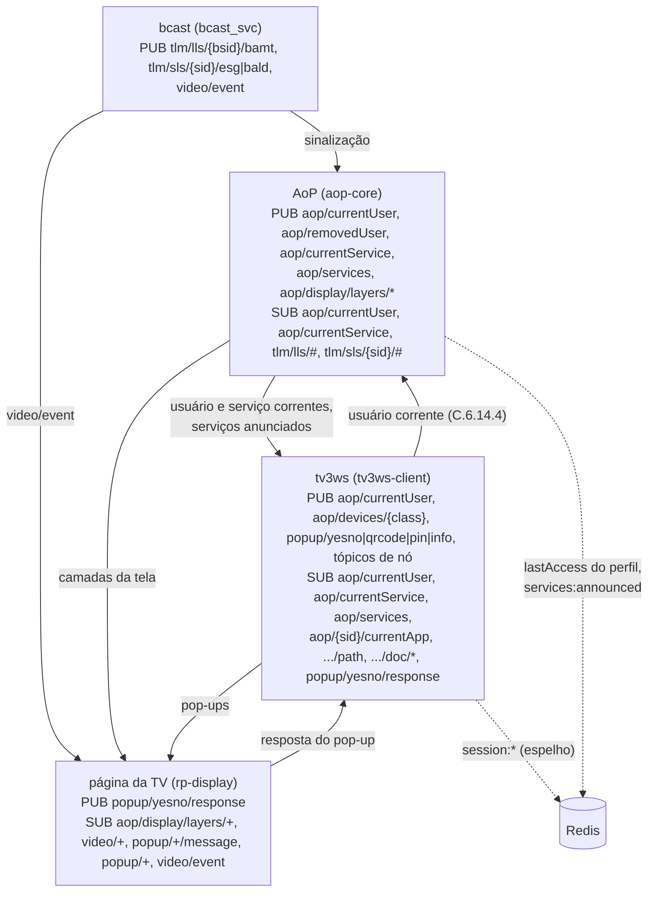

# Mapa de tópicos MQTT — TV 3.0

> O barramento MQTT e os nomes de tópico são decisões deste projeto; a ABNT NBR 25608 não define a comunicação interna do receptor. O mapa com a descrição de cada tópico também está em `docs/mqtt-topicos.md` da raiz do TV30.

## Clientes MQTT

| Client ID | Processo | Arquivo | Conexão |
|---|---|---|---|
| `aop-core` | AoP (servidor) | `aop/src/core.js` | `mqtt://${MQTT_HOST}` (no compose, `mosquitto:1883`) |
| `rp-display` | página da TV, no navegador | `aop/src/modules/graphic-overlays/view.ejs`, `connect()` | `ws://<host da página>/mqtt`, que o AoP repassa à 9001 do mosquitto (`aop/src/mqtt-ws.js`) |
| `tv3ws-client` | tv3ws | `tv3ws/src/mqtt-client.ts` | `mqtt://${MQTT_HOST}`, MQTT 5 |
| `bcast_svc` | bcast | `bcast/src/index.ts` | `mqtt://${MQTT_HOST}`, MQTT 5 |
| (sem cliente) | plugin C do broker | `infra/mqtt-broker/plugin/src/` | publica de dentro do broker (`mosquitto_broker_publish`) |

Todas as assinaturas dos três primeiros usam *no local* (`noLocal` no AoP e na página, `nl: true` no tv3ws): ninguém recebe a própria publicação. O tv3ws registra os tratadores por tópico exato (`addTopicHandler`, em `tv3ws/src/mqtt-client.ts`), com QoS 1.

A coluna **Esquema** diz se o tópico tem esquema em `infra/mqtt-broker/plugin/config/schemas.json`, que o plugin confere na publicação ([09](09-schema-validation.md)).

---

## Sessão e usuário

### `aop/currentUser` — retido; esquema: string de até 64 caracteres

| Direção | Arquivo | Detalhe |
|---|---|---|
| **PUB** | `aop/src/core.js` | `setCurrentUser()`: grava antes o `lastAccess` do perfil; payload: id do perfil |
| **PUB** | `tv3ws/src/api/user/service.ts` | `setCurrentUser()` (C.6.14.4): confere antes o serviço em uso, o perfil e a visibilidade dele (300, 305, 405) e grava `session:current-user` |
| **SUB** | `aop/src/core.js` | assinado no `connect` (mapa `_topics`); `loadCurrentUser()`: grava o `lastAccess` do perfil (`touchLastAccess`) |
| **PUB** | `aop/src/core.js` | `profileRemoved()`: payload `''`, quando o perfil removido pelo telespectador era o corrente; o corrente passa a ser o escolhido no seletor |
| **SUB** | `tv3ws/src/api/user/service.ts` | `updateCurrentUser()`: `session:current-user` (`tv30_sessao_usuario`) |

O payload é o id do perfil (UUID) em texto puro. O plugin do broker valida como string o payload que não é um texto JSON inteiro ([09](09-schema-validation.md)).

### `aop/removedUser` — não retido; esquema: string de 1 a 64 caracteres

| Direção | Arquivo | Detalhe |
|---|---|---|
| **PUB** | `aop/src/core.js` | `profileRemoved()`: o id do perfil que o telespectador removeu no seletor, depois de removidos o perfil, a visibilidade, os atributos de emissora e o arquivo do avatar |

Nenhum serviço deste repositório assina.

### `aop/currentService` — retido; esquema: string de até 256 caracteres

| Direção | Arquivo | Detalhe |
|---|---|---|
| **PUB** | `aop/src/core.js` | `setCurrentService()`: payload: id do serviço |
| **PUB** | `aop/src/core.js` | `unsetCurrentService()`: payload `''` |
| **SUB** | `aop/src/core.js` | assinado no `connect` (mapa `_topics`); `loadCurrentService()` |
| **SUB** | `tv3ws/src/api/user/service.ts` | `updateCurrentService()`: `session:current-service-id` (`tv30_sessao_servico_id`) |
| **SUB** | `tv3ws/src/core.ts` | `currentService()`: `session:current-service` (`tv30_sessao_servico`) e assinatura de `aop/{serviceId}/currentApp` |

### `aop/services` — retido; esquema: array de `{"serviceContextId"}`

| Direção | Arquivo | Detalhe |
|---|---|---|
| **PUB** | `aop/src/modules/transport-layer-metadata-lls/index.js` | unidade `aop-transport-layer-metadata-lls`, no processo do AoP: os serviços anunciados na LLS, `[{"serviceContextId": "<globalServiceId>"}, ...]`, um por BAM, sem repetição (`[]` = nenhum). Sai depois de gravar o mesmo conteúdo em `services:announced` (`tv30_servicos_anunciados`), a cada BAMT recebida ou retirada e na partida; falha do Redis tenta de novo antes de publicar |
| **SUB** | `tv3ws/src/core.ts` | `loadServiceData()`: guarda os `serviceContextId`; mensagem vazia = nenhum serviço, e a que não é JSON é ignorada, com log. Nenhuma resposta da API usa a lista: sem SLT, não há `serviceId` nem `serviceName` |

---

## Dispositivos remotos

### `aop/devices/{devclass}` — retido; sem assinante neste repositório

| Direção | Arquivo | Detalhe |
|---|---|---|
| **PUB** | `tv3ws/src/modules/remotedevice-manager/manager.ts` | `addRemoteDevice()`: array JSON de handles, publicado depois de gravar o espelho no Redis |
| **PUB** | `tv3ws/src/modules/remotedevice-manager/manager.ts` | `removeRemoteDevice()`: array JSON de handles, ou `''` se não sobrou nenhum; também depois da remoção no Redis |

---

## Aplicação e nós — o tv3ws assina; sem publicador neste repositório

### `aop/{serviceId}/currentApp`

| Direção | Arquivo | Detalhe |
|---|---|---|
| **SUB** | `tv3ws/src/core.ts` | `setAppId()`: assinado na troca de serviço (`currentService()`). Trocar de aplicação zera o diretório da aplicação (`core.app.url`) até chegar o `.../path` da nova, e a mensagem vazia encerra a aplicação corrente (tira os tratadores de `.../path` e `.../doc/nodes` e zera o diretório). O contrato do tópico (mensagem vazia retida = fim da aplicação) está na descrição do esquema `aop/+/currentApp` do `schemas.json` |

### `aop/{serviceId}/{appId}/path` e `aop/{serviceId}/{appId}/doc/nodes`

| Direção | Arquivo | Detalhe |
|---|---|---|
| **SUB** | `tv3ws/src/core.ts` | `.../path`: `setAppBaseURL()`, URL base da app (de onde a C.6.4.7 lê os arquivos) |
| **SUB** | `tv3ws/src/core.ts` | `.../doc/nodes`: `setAppNodes()`, array de nós; associa os nós aos dispositivos remotos |

### Tópicos de nó: `aop/{serviceId}/{appId}/doc/{nó}/...`

`{nó}` é o id do nó com `.` trocado por `/` (`tv3ws/src/modules/remotedevice-manager/remote-device.ts`, `setNode`). Os tópicos só existem enquanto um nó está associado a um dispositivo remoto.

| Direção | Arquivo | Detalhe |
|---|---|---|
| **SUB** | `.../remote-device.ts`, `setNode()` | `{nó}/interfaces`: `setNodeInterfaces()`; a assinatura sai depois da primeira mensagem |
| **SUB** | `.../remote-device.ts`, `setNode()` | `{nó}/preparationEvent/actionNotification` e `{nó}/presentationEvent/actionNotification`: `onMqttMessage()`, repassado ao dispositivo pelo WebSocket |
| **SUB** | `.../remote-device.ts`, `setNodeInterfaces()` | `{nó}/{interface}/attributionEvent/value`: `setPropertyValue()`, uma por interface de propriedade; sai depois do primeiro valor |
| **PUB** | `.../remote-device.ts`, `publishTransitionMetadata()` | `{nó}[/{label}]/{eventType}Event[/OK]/eventNotification`: a transição vinda do dispositivo; não retido |
| **PUB** | `.../remote-device.ts`, `publishTransitionMetadata()` | o mesmo prefixo + `/user`: usuário, só em `selection`; retido |
| **PUB** | `.../remote-device.ts`, `publishTransitionMetadata()` | o mesmo prefixo + `/value`: valor, só em `attribution`; retido |

O `/user` e o `/value` saem retidos porque o `publish` do tv3ws tem `retain = true` por padrão (`tv3ws/src/mqtt-client.ts`, `publish`), e as duas chamadas não passam o terceiro argumento; o `eventNotification` passa `false`.

---

## Camadas da tela

Publicadas pelo AoP sem retenção e assinadas pela página da TV (`aop/src/modules/graphic-overlays/view.ejs`, `subscribe_topics()`).

| Tópico | Esquema | PUB (`aop/src/core.js`) | SUB (`view.ejs`) |
|---|---|---|---|
| `aop/display/layers/rxgui` | sim | `setDisplayGui()`: caminho da tela do AoP | `aop/display/layers/+` |
| `aop/display/layers/graphics` | sim | `setDisplayGraphics()`: URL da app no host próprio, `http://<rótulo>.<APPS_DOMAIN>:<porta>/graphicsAppProxy/...`, ou `''` | `aop/display/layers/+` |
| `aop/display/layers/video/url` | sim | `setVideoURL()`: `/videoStreamProxy/<arquivo>` para `.m3u8` e `.mpd`; senão a URL recebida | `aop/display/layers/video/+` |
| `aop/display/layers/video/size` | sim | `setVideoSize()`: JSON `{top, left, width, height}` | `aop/display/layers/video/+` |

---

## Pop-ups

| Tópico | Esquema | PUB | SUB |
|---|---|---|---|
| `aop/display/layers/popup/yesno/message` | não | `tv3ws/src/core.ts`, `showYesNoPopUpAsync()`: JSON `{value, timeout}`; não retido | `view.ejs`, `aop/display/layers/popup/+/message` |
| `aop/display/layers/popup/yesno/response` | não | `aop/public/js/popup.js`, `presentPopup()`: `"false"` (fim do tempo do pop-up), `"true"` (`PopupYes`) ou `"false"` (`PopupNo`) | `tv3ws/src/core.ts`: assinado em `showYesNoPopUpAsync()` e tirado na resposta ou no fim do tempo; só `"true"` autoriza |
| `aop/display/layers/popup/qrcode` | não | `tv3ws/src/core.ts`: `showQRCodePopUp()`, abertura, JSON `{value, timeout}`, com prazo de 120 s; `closeQRCodePopUp()`, fechamento, `{"close":true}`, no fim do pareamento. Não retido | `view.ejs`, `aop/display/layers/popup/+` |
| `aop/display/layers/popup/pin` | não | `tv3ws/src/core.ts`: `showPINPopUp()`, abertura, JSON `{value, timeout}`, com prazo de 120 s; `closePINPopUp()`, fechamento, `{"close":true}`, no fim do pareamento. Não retido | `view.ejs`, `aop/display/layers/popup/+` |
| `aop/display/layers/popup/info` | não | `tv3ws/src/api/user/service.ts`, `notifyUserOfWrite()`, chamada por `writeBroadcasterAttrs()` (C.6.14.5) depois da gravação, só quando algum valor mudou: JSON `{value, timeout}`, com `timeout` de 5000 ms. Não retido | `view.ejs`, `aop/display/layers/popup/+` |

A página trata as mensagens de pop-up em `handlePopupMessage` (`aop/public/js/popup.js`), chamada por `mqtt_message` (`view.ejs`). Pareamento (C.4.3.2 e C.4.3.3) e demais regras:
- **fechamento:** `{"close":true}` no tópico do QR code ou do PIN fecha o pop-up aberto daquele tipo; com pop-up de outro tipo na tela, ou sem pop-up, nada muda. No sim/não, o `{"close":true}` é ignorado. Quem publica é o tv3ws, no fim do pareamento (o `/tv3/token` com o desafio resolvido), e só se o pop-up daquele tipo ainda for do cliente que pareou (`endPairing`, em `tv3ws/src/api/client-identification/service.ts`). Abertura e fechamento saem do mesmo cliente MQTT, no mesmo tópico e com a mesma QoS, e chegam nessa ordem;
- **um pop-up só:** o pop-up novo substitui o da tela, com o prazo e os botões dele (`presentPopup`), e o prazo do anterior deixa de valer. Um sim/não substituído não publica resposta (o tv3ws o dá por expirado no fim dos 10 s dele). A exceção é o aviso (`info`, abaixo). O tv3ws não manda um sim/não com outro sim/não, QR code ou PIN na tela: o `/tv3/authorize` novo recebe 103 (`reservarCamada`, em `tv3ws/src/api/client-identification/service.ts`). A página substitui, se receber;
- **aviso (`info`):** não pede resposta, fecha no `timeout` (5 s se ausente ou inválido; o `{"close":true}` não o fecha) e nunca substitui o pop-up da tela: com qualquer pop-up aberto, espera numa fila (`enqueueInfo`) e aparece quando a camada fica livre (`showNextInfo`, chamada por `ClosePopup`). Com 3 avisos esperando (`INFO_QUEUE_MAX`), o novo é descartado e registrado no console. Um aviso na tela que um sim/não, QR code ou PIN substitui volta para o começo da fila;
- **mensagem inválida** (JSON quebrado, não objeto, sem `value` de texto, tipo desconhecido) vai para o console e é ignorada. O `client.on('message')` da página também captura exceções (`view.ejs`, `connect()`), para a página não parar de tratar as mensagens seguintes;
- **escape:** o texto do sim/não (que leva o `display-name` do cliente), o PIN e o aviso (que leva o apelido do perfil e o nome do serviço) entram no HTML escapados (`escapeHtml`); o QR code é desenhado pela biblioteca a partir do texto.

---

## Sinalização (LLS e SLS) e evento de vídeo — publicados pelo bcast

### `tlm/lls/{bsid}/bamt` — retido; esquema `tlm/lls/+/bamt`

| Direção | Arquivo | Detalhe |
|---|---|---|
| **PUB** | `bcast/src/index.ts` | BAMT em JSON, no `connect` do cliente MQTT; `''` na limpeza (`clean_topics()`) |
| **SUB** | `aop/src/core.js` → `aop/src/modules/transport-layer-metadata-lls/index.js` | `tlm/lls/#`, assinado no `connect` (mapa `_topics`), entregue a `receive()` da unidade `aop-transport-layer-metadata-lls`: só trata `tlm/lls/<bsid>/bamt`; payload vazio retira o fluxo `<bsid>`; serviço repetido entre fluxos vale com o BAM da BAMT recebida por último. Cada mudança regrava `services:announced` e publica `aop/services` |

`{bsid}` é o `BSID` do bcast (no compose da raiz, `tv30-default`).

### `tlm/sls/{serviceId}/esg` e `tlm/sls/{serviceId}/bald` — retidos; esquemas `tlm/sls/+/esg` e `tlm/sls/+/bald`

| Direção | Arquivo | Detalhe |
|---|---|---|
| **PUB** | `bcast/src/modules/{eduplay,uff,users-test,webmedia}/index.ts` | `sendSLS()`: ESG e BALD do serviço; `''` ao descartar (`dispose()`) |
| **SUB** | `aop/src/core.js` | `tlm/sls/{serviceId}/#`: `loadSLSMetadata()`; assinado em `setCurrentService()` e tirado em `unsetCurrentService()` |

### `video/event` — não retido; esquema: sim

| Direção | Arquivo | Detalhe |
|---|---|---|
| **PUB** | `bcast/src/modules/live_stream/index.ts` | `notify_event()`: ação do segmento HLS em JSON |
| **SUB** | `aop/src/modules/graphic-overlays/view.ejs` | `mqtt_message()`: dispara `stream_event` na app da camada gráfica (por `postMessage` à origem dela, `graphics_event()`) |

---

## Tópicos do plugin do broker e do teste de latência

| Tópico | Quem publica | Detalhe |
|---|---|---|
| `errors/{client_id}` | plugin C (`mosquitto_plugin.c`, `publish_error()`) | JSON da recusa de esquema (`INVALID_JSON` ou `SCHEMA_VALIDATION_FAILED`); QoS 0, não retido. Nenhum serviço assina. Sempre JSON válido (RFC 8259) e UTF-8 válido, com até 2047 bytes e `"truncated":true` quando algum campo foi cortado (`error_json_build`, em `src/error_json.c`); no `{client_id}` do tópico, `+`, `#`, `/` e controles viram `_`, e o tópico tem até 255 bytes, cortado entre caracteres UTF-8 inteiros (`error_json_topic`). Formato em [09](09-schema-validation.md) |
| `PublisherResponseTime{id}/iteration{n}` | `infra/mqtt-broker/brokertimetest/` (`server.js`, `headless-run.js`) | requisição do teste de latência; o plugin o intercepta e o deixa passar |
| `PluginResponseTime{id}/iteration{n}` | plugin C (`response_time_tester.c`, `handle_response_time_test()`) | resposta ao teste, `{localtime, id, iteration, diffTime}`; QoS 0, não retido; o testador assina `PluginResponseTime{id}/#`. O `id` sai escapado (`error_json_string`), e a resposta que não cabe em 511 bytes não sai |

---

## Visão geral

## Retenção

| Tópico | retain | Quem publica |
|---|---|---|
| `aop/currentUser` | `true` | AoP e tv3ws |
| `aop/currentService` | `true` | AoP |
| `aop/services` | `true` | AoP (`aop-transport-layer-metadata-lls`) |
| `aop/devices/{devclass}` | `true` | tv3ws |
| `tlm/lls/{bsid}/bamt`, `tlm/sls/{serviceId}/esg`, `tlm/sls/{serviceId}/bald` | `true` | bcast |
| tópicos de nó `.../user` e `.../value` | `true` (padrão do `publish` do tv3ws) | tv3ws |
| camadas da tela, pop-ups e resposta, `aop/removedUser`, `eventNotification`, `video/event`, `errors/*`, `PluginResponseTime*` | `false` | AoP, tv3ws, página, bcast e plugin |
