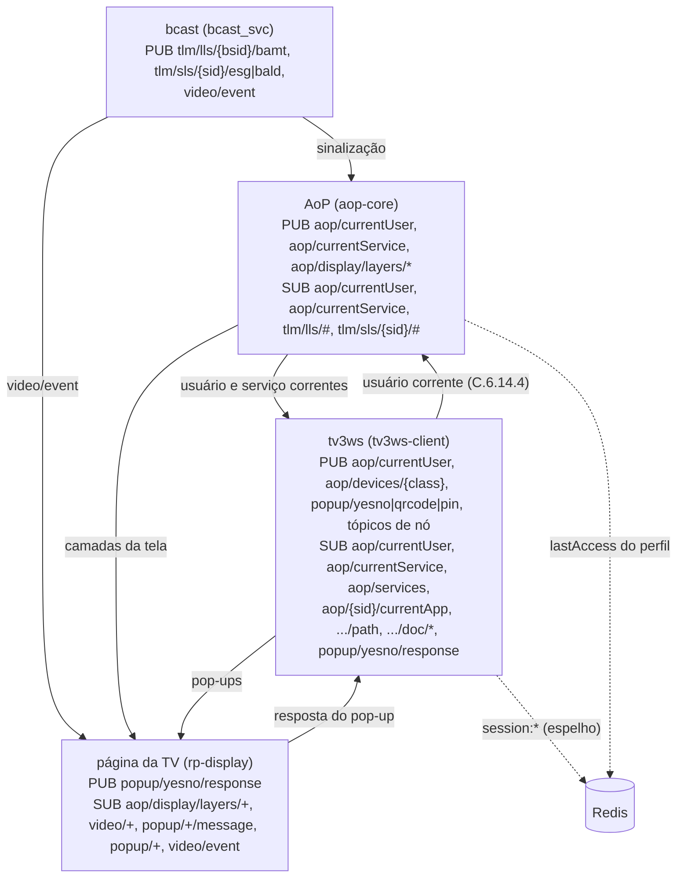

# Mapa de tópicos MQTT — TV 3.0

> **Estado do código em 12/10/2026**, conferido por busca de `publish`, `subscribe` e `addTopicHandler` em `aop/src`, `aop/public/js`, `tv3ws/src`, `bcast/src` e `infra/mqtt-broker`; as linhas são as desta data. Até 12/10 este mapa citava módulos do AoP com os nomes antigos (`disp-lyr`, hoje `graphic-overlays`), linhas que tinham mudado e tópicos de nó com formato que o código não usa, não listava o bcast nem o plugin do broker e dizia que só três tópicos eram retidos.
>
> O barramento MQTT e os nomes de tópico são decisões deste projeto; a ABNT NBR 25608 não define a comunicação interna do receptor. O mapa com a descrição de cada tópico também está em `docs/mqtt-topicos.md` da raiz do TV30.

## Clientes MQTT

| Client ID | Processo | Arquivo | Conexão |
|---|---|---|---|
| `aop-core` | AoP (servidor) | `aop/src/core.js`, linha 42 | `mqtt://${MQTT_HOST}` (no compose, `mosquitto:1883`) |
| `rp-display` | página da TV, no navegador | `aop/src/modules/graphic-overlays/view.ejs`, linha 148 | `ws://<host da página>/mqtt`, que o AoP repassa à 9001 do mosquitto (`aop/src/mqtt-ws.js`) |
| `tv3ws-client` | tv3ws | `tv3ws/src/mqtt-client.ts`, linha 7 | `mqtt://${MQTT_HOST}`, MQTT 5 |
| `bcast_svc` | bcast | `bcast/src/index.ts`, linha 52 | `mqtt://${MQTT_HOST}`, MQTT 5 |
| (sem cliente) | plugin C do broker | `infra/mqtt-broker/plugin/src/` | publica de dentro do broker (`mosquitto_broker_publish`) |

Todas as assinaturas dos três primeiros usam *no local* (`noLocal` no AoP e na página, `nl: true` no tv3ws): ninguém recebe a própria publicação. O tv3ws registra os tratadores por tópico exato (`addTopicHandler`, `tv3ws/src/mqtt-client.ts`, linhas 57–67), com QoS 1.

A coluna **Esquema** diz se o tópico tem esquema em `infra/mqtt-broker/plugin/config/schemas.json`, que o plugin confere na publicação ([09](09-schema-validation.md)).

---

## Sessão e usuário

### `aop/currentUser` — retido; esquema: string de até 64 caracteres

| Direção | Arquivo | Linha | Detalhe |
|---|---|---|---|
| **PUB** | `aop/src/core.js` | 246 | `setCurrentUser()`: grava antes o `lastAccess` do perfil; payload: id do perfil |
| **PUB** | `tv3ws/src/api/user/service.ts` | 111 | `setCurrentUser()` (C.6.14.4): grava antes `session:current-user` |
| **SUB** | `aop/src/core.js` | 93 (tratador na 233) | `loadCurrentUser()`: grava o `lastAccess` do perfil (`touchLastAccess`, D-0510-5) |
| **SUB** | `tv3ws/src/api/user/service.ts` | 70 | `updateCurrentUser()`: `session:current-user` (`tv30_sessao_usuario`) |

### `aop/currentService` — retido; esquema: string de até 256 caracteres

| Direção | Arquivo | Linha | Detalhe |
|---|---|---|---|
| **PUB** | `aop/src/core.js` | 273 | `setCurrentService()`: payload: id do serviço |
| **PUB** | `aop/src/core.js` | 279 | `unsetCurrentService()`: payload `''` |
| **SUB** | `aop/src/core.js` | 93 (tratador na 267) | `loadCurrentService()` |
| **SUB** | `tv3ws/src/api/user/service.ts` | 71 | `updateCurrentService()`: `session:current-service-id` (`tv30_sessao_servico_id`) |
| **SUB** | `tv3ws/src/core.ts` | 174 (tratador na 125) | `currentService()`: `session:current-service` (`tv30_sessao_servico`) e assinatura de `aop/{serviceId}/currentApp` |

### `aop/services` — sem publicador neste repositório

| Direção | Arquivo | Linha | Detalhe |
|---|---|---|---|
| **SUB** | `tv3ws/src/core.ts` | 182 (tratador na 176) | `loadServiceData()`: lista de serviços em JSON |

### `aop/users` — fora de uso

Desde 10/10 ninguém publica nem assina o tópico, e o esquema dele saiu do `schemas.json`. O tv3ws deixou de sincronizar perfis a partir do `userData.json` na reunião de 05/10 com o Joel (D-0510-5), e a plataforma (AoP) é a dona dos perfis.

---

## Dispositivos remotos

### `aop/devices/{devclass}` — retido; sem assinante neste repositório

| Direção | Arquivo | Linha | Detalhe |
|---|---|---|---|
| **PUB** | `tv3ws/src/modules/remotedevice-manager/manager.ts` | 87 | `addRemoteDevice()`: array JSON de handles, publicado depois de gravar o espelho no Redis (D-0510-6) |
| **PUB** | `tv3ws/src/modules/remotedevice-manager/manager.ts` | 110 | `removeRemoteDevice()`: array JSON de handles, ou `''` se não sobrou nenhum; também depois da remoção no Redis |

---

## Aplicação e nós — o tv3ws assina; sem publicador neste repositório

### `aop/{serviceId}/currentApp`

| Direção | Arquivo | Linha | Detalhe |
|---|---|---|---|
| **SUB** | `tv3ws/src/core.ts` | 150 | `setAppId()`: assinado na troca de serviço (`currentService()`) |

### `aop/{serviceId}/{appId}/path` e `aop/{serviceId}/{appId}/doc/nodes`

| Direção | Arquivo | Linha | Detalhe |
|---|---|---|---|
| **SUB** | `tv3ws/src/core.ts` | 97 | `.../path`: `setAppBaseURL()`, URL base da app (de onde a C.6.4.7 lê os arquivos) |
| **SUB** | `tv3ws/src/core.ts` | 103 | `.../doc/nodes`: `setAppNodes()`, array de nós; associa os nós aos dispositivos remotos |

### Tópicos de nó: `aop/{serviceId}/{appId}/doc/{nó}/...`

`{nó}` é o id do nó com `.` trocado por `/` (`tv3ws/src/modules/remotedevice-manager/remote-device.ts`, `setNode`). Os tópicos só existem enquanto um nó está associado a um dispositivo remoto.

| Direção | Arquivo | Linha | Detalhe |
|---|---|---|---|
| **SUB** | `.../remote-device.ts` | 355 | `{nó}/interfaces`: `setNodeInterfaces()`; a assinatura sai depois da primeira mensagem |
| **SUB** | `.../remote-device.ts` | 357–358 | `{nó}/preparationEvent/actionNotification` e `{nó}/presentationEvent/actionNotification`: `onMqttMessage()`, repassado ao dispositivo pelo WebSocket |
| **SUB** | `.../remote-device.ts` | 388 | `{nó}/{interface}/attributionEvent/value`: `setPropertyValue()`, uma por interface de propriedade; sai depois do primeiro valor |
| **PUB** | `.../remote-device.ts` | 220 | `{nó}[/{label}]/{eventType}Event[/OK]/eventNotification`: a transição vinda do dispositivo (`publishTransitionMetadata()`, linha 208); não retido |
| **PUB** | `.../remote-device.ts` | 223 | o mesmo prefixo + `/user`: usuário, só em `selection`; retido |
| **PUB** | `.../remote-device.ts` | 226 | o mesmo prefixo + `/value`: valor, só em `attribution`; retido |

O `/user` e o `/value` saem retidos porque o `publish` do tv3ws tem `retain = true` por padrão (`tv3ws/src/mqtt-client.ts`, linha 95), e as duas chamadas não passam o terceiro argumento; o `eventNotification` passa `false`.

---

## Camadas da tela

Publicadas pelo AoP sem retenção e assinadas pela página da TV (`aop/src/modules/graphic-overlays/view.ejs`).

| Tópico | Esquema | PUB (`aop/src/core.js`) | SUB (`view.ejs`) |
|---|---|---|---|
| `aop/display/layers/rxgui` | sim | 133, `setDisplayGui()`: caminho da tela do AoP | 159, `aop/display/layers/+` |
| `aop/display/layers/graphics` | sim | 161, `setDisplayGraphics()`: URL da app no host próprio, `http://<rótulo>.<APPS_DOMAIN>:<porta>/graphicsAppProxy/...` (P1.3), ou `''` | 159, `aop/display/layers/+` |
| `aop/display/layers/video/url` | sim | 169 e 172, `setVideoURL()`: `/videoStreamProxy/<arquivo>` para `.m3u8` e `.mpd`; senão a URL recebida | 160, `aop/display/layers/video/+` |
| `aop/display/layers/video/size` | sim | 177, `setVideoSize()`: JSON `{top, left, width, height}` | 160, `aop/display/layers/video/+` |

---

## Pop-ups

| Tópico | Esquema | PUB | SUB |
|---|---|---|---|
| `aop/display/layers/popup/yesno/message` | não | `tv3ws/src/core.ts`, 272, `showYesNoPopUpAsync()`: JSON `{value, timeout}`; não retido | `view.ejs`, 161, `aop/display/layers/popup/+/message` |
| `aop/display/layers/popup/yesno/response` | não | `aop/public/js/popup.js`, 21, 27 e 33: `"true"` (Sim) ou `"false"` (Não, ou fim do tempo do pop-up) | `tv3ws/src/core.ts`, 270: assinado em `showYesNoPopUpAsync()` e tirado na resposta ou no fim do tempo (253); só `"true"` autoriza |
| `aop/display/layers/popup/qrcode` | não | `tv3ws/src/core.ts`, 279, `showQRCodePopUp()`: JSON `{value, timeout}`; não retido | `view.ejs`, 166, `aop/display/layers/popup/+` |
| `aop/display/layers/popup/pin` | não | `tv3ws/src/core.ts`, 285, `showPINPopUp()`: JSON `{value, timeout}`; não retido | `view.ejs`, 166, `aop/display/layers/popup/+` |

---

## Sinalização (LLS e SLS) e evento de vídeo — publicados pelo bcast

### `tlm/lls/{bsid}/bamt` — retido; esquema `tlm/lls/+/bamt`

| Direção | Arquivo | Linha | Detalhe |
|---|---|---|---|
| **PUB** | `bcast/src/index.ts` | 105 | BAMT em JSON; `''` na limpeza (linha 137) |
| **SUB** | `aop/src/core.js` | 93 (tratador na 288) | `tlm/lls/#`: `loadLLSMetadata()`, que só trata o último nível `bamt`; com payload vazio, limpa a lista de serviços e assina de novo |

`{bsid}` é o `BSID` do bcast (no compose da raiz, `tv30-default`).

### `tlm/sls/{serviceId}/esg` e `tlm/sls/{serviceId}/bald` — retidos; esquemas `tlm/sls/+/esg` e `tlm/sls/+/bald`

| Direção | Arquivo | Linha | Detalhe |
|---|---|---|---|
| **PUB** | `bcast/src/modules/eduplay/index.ts` | 37–38 (`''` em 43–44) | ESG e BALD do serviço; vazio ao descartar |
| **PUB** | `bcast/src/modules/uff/index.ts` | 33–34 (`''` em 38–39) | idem |
| **PUB** | `bcast/src/modules/users-test/index.ts` | 33–34 (`''` em 38–39) | idem |
| **PUB** | `bcast/src/modules/webmedia/index.ts` | 44 e 47 (`''` em 53–54) | idem |
| **SUB** | `aop/src/core.js` | 274 (tratador na 314) | `tlm/sls/{serviceId}/#`: `loadSLSMetadata()`; assinado em `setCurrentService()` e tirado em `unsetCurrentService()` (278) |

### `video/event` — não retido; esquema: sim

| Direção | Arquivo | Linha | Detalhe |
|---|---|---|---|
| **PUB** | `bcast/src/modules/live_stream/index.ts` | 114 | ação do segmento HLS em JSON |
| **SUB** | `aop/src/modules/graphic-overlays/view.ejs` | 167 | dispara `stream_event` na app da camada gráfica (por `postMessage` à origem dela, desde o P1.3) |

---

## Tópicos do plugin do broker e do teste de latência

| Tópico | Quem publica | Detalhe |
|---|---|---|
| `errors/{client_id}` | plugin C (`mosquitto_plugin.c`, linha 74, `publish_error()`) | JSON da recusa de esquema; QoS 0, não retido. Nenhum serviço assina |
| `PublisherResponseTime{id}/iteration{n}` | `infra/mqtt-broker/brokertimetest/` (`server.js`, `headless-run.js`) | pedido do teste de latência; o plugin o intercepta e o deixa passar |
| `PluginResponseTime{id}/iteration{n}` | plugin C (`response_time_tester.c`, linha 86) | resposta ao teste; QoS 0, não retido; o testador assina `PluginResponseTime{id}/#` |

---

## Visão geral

## Retenção

| Tópico | retain | Quem publica |
|---|---|---|
| `aop/currentUser` | `true` | AoP e tv3ws |
| `aop/currentService` | `true` | AoP |
| `aop/devices/{devclass}` | `true` | tv3ws |
| `tlm/lls/{bsid}/bamt`, `tlm/sls/{serviceId}/esg`, `tlm/sls/{serviceId}/bald` | `true` | bcast |
| tópicos de nó `.../user` e `.../value` | `true` (padrão do `publish` do tv3ws) | tv3ws |
| camadas da tela, pop-ups e resposta, `eventNotification`, `video/event`, `errors/*`, `PluginResponseTime*` | `false` | AoP, tv3ws, página, bcast e plugin |
